<div align="center">

# Patchgrid

### Multi-tenant IT service management, built the way a production SaaS has to be.

Incidents, service requests, problems and changes for IT and security teams. Every company gets its own
subdomain, and its data is isolated by the database itself.

<p>
<a href="https://github.com/KhaledSaeed18/patchgrid/actions/workflows/ci.yml"></a>
<a href="docs/ENGINEERING.md#testing"></a>
<a href="docs/TENANCY.md"></a>
<a href="docs/decisions/README.md"></a>
<a href="https://github.com/KhaledSaeed18/patchgrid/commits/main"></a>
<a href="LICENSE"></a>
</p>

<p>


</p>

[Tour](#a-tour-of-the-product) · [Run it](#run-it-in-five-minutes) · [Architecture](#architecture) ·
[Engineering](#engineering-highlights) · [Documentation](#documentation) · [Decisions](docs/decisions/README.md)

<picture><source media="(prefers-color-scheme: dark)" srcset="docs/screenshots/dark/queue.png">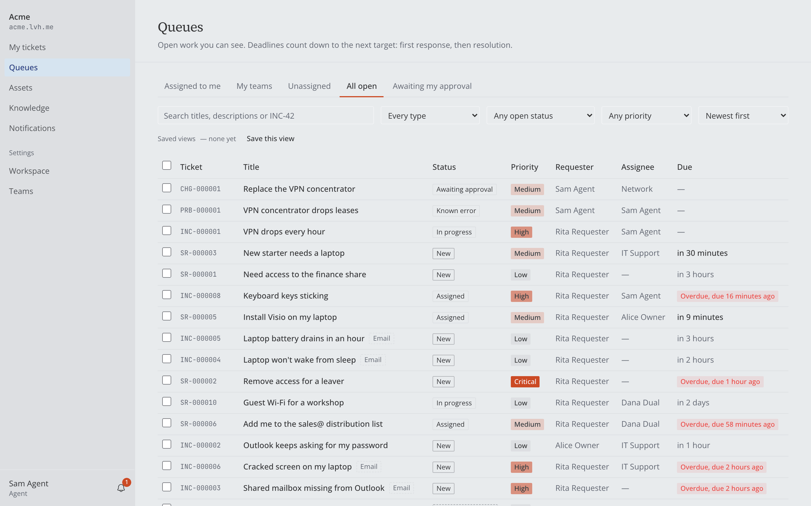</picture>

<sub>Every screenshot is generated from the seeded demo and follows your GitHub theme: switch it between light and dark to see the other.</sub>

</div>

---

## Why Patchgrid

Patchgrid is a ticketing and operations platform for internal IT desks: a scoped-down Freshservice or
Jira Service Management. It is a portfolio project, built as if it were going to production. It has three
deployables, a tenant per subdomain, and isolation enforced by the schema, the application and Postgres
row-level security. Every significant design choice has a written decision record.

Three ideas run through the whole system:

> **An incident is not a change.** Four ITIL record types, each with its own lifecycle, rather than one
> generic "ticket" with a status dropdown.
>
> **Nobody types a priority.** Priority is computed from impact × urgency, and the SLA deadlines follow
> from it. A client that sends a priority gets a `400`.
>
> **Isolation is a property of the schema, not a habit.** A reference from one tenant's data to another's
> cannot be written down, and the application's database role cannot bypass row-level security.

<table>
  <tr>
    <td><b>Record types</b></td>
    <td>Incident · Service request · Problem · Change, each with its own state machine</td>
  </tr>
  <tr>
    <td><b>Deployables</b></td>
    <td>Marketing site (Next.js) · Tenant workspace (Next.js) · API and workers (NestJS)</td>
  </tr>
  <tr>
    <td><b>Isolation</b></td>
    <td>Five layers, from composite foreign keys to <code>FORCE ROW LEVEL SECURITY</code>, gated by a dedicated suite</td>
  </tr>
  <tr>
    <td><b>Authorization</b></td>
    <td>Four cumulative roles, team leads as a scoped capability, a 400-test authorization suite in CI</td>
  </tr>
  <tr>
    <td><b>Tests</b></td>
    <td>2,300+ automated: unit, integration on real Postgres and Redis, tenancy, authorization, browser</td>
  </tr>
  <tr>
    <td><b>Deployment</b></td>
    <td>A production rehearsal on emulated AWS (ECS, ALB, RDS, ElastiCache, S3, SES), deployed from nothing in CI</td>
  </tr>
</table>

## A tour of the product

Forty screens across the five ways people use Patchgrid: as an agent, as a requester, as a workspace
owner, as someone who belongs to two companies, and as one of Patchgrid's own operators. All of it is the
seeded demo you get from `pnpm local:up`, and none of it is mocked.

### The service desk

An agent's day: queues that count down, four record types with four lifecycles, and changes that need a second pair of eyes.

<table>
  <tr>
    <td width="50%" valign="top"><picture><source media="(prefers-color-scheme: dark)" srcset="docs/screenshots/dark/queue-bulk.png">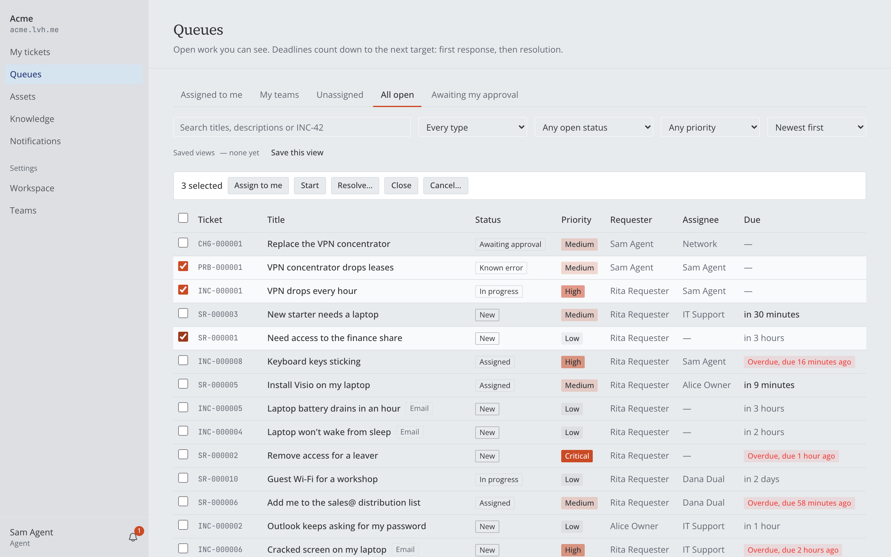</picture><br><b>Bulk actions</b><br>Up to two hundred tickets at once. Each is authorized on its own, and the result is reported per ticket.</td>
    <td width="50%" valign="top"><picture><source media="(prefers-color-scheme: dark)" srcset="docs/screenshots/dark/approvals.png">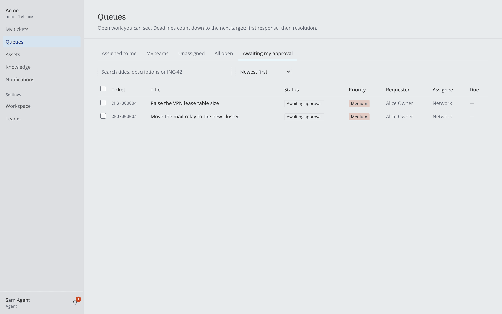</picture><br><b>Awaiting my approval</b><br>A team lead's queue of changes to decide. A change's author is never offered its approval.</td>
  </tr>
  <tr>
    <td width="50%" valign="top"><picture><source media="(prefers-color-scheme: dark)" srcset="docs/screenshots/dark/problem.png">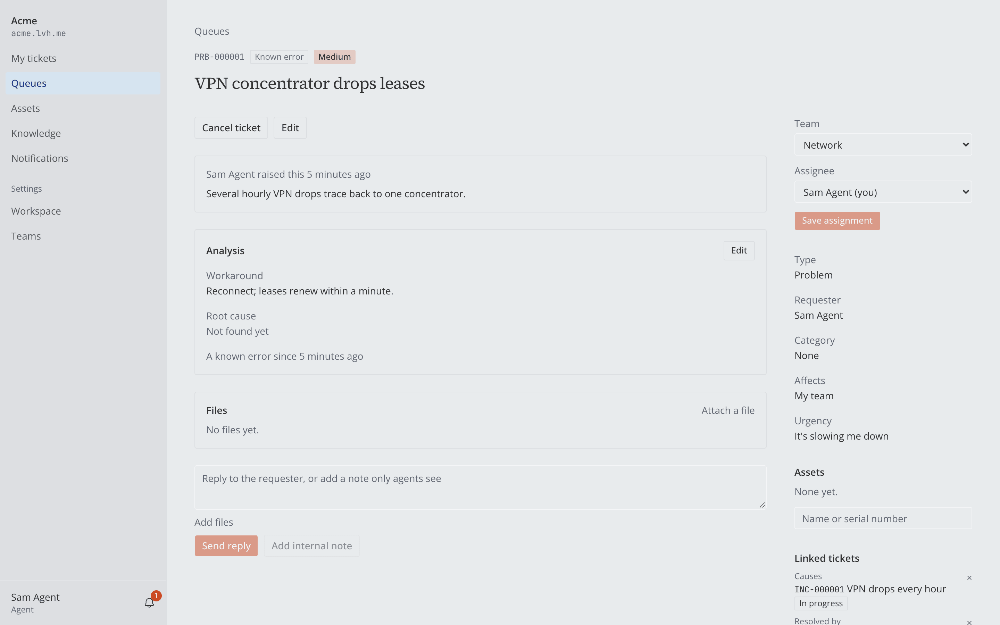</picture><br><b>A problem</b><br>Root cause, workaround and a known-error state, linked to the incidents it explains.</td>
    <td width="50%" valign="top"><picture><source media="(prefers-color-scheme: dark)" srcset="docs/screenshots/dark/change.png"></picture><br><b>A change</b><br>A plan, a window, a risk and a rollback, decided by someone other than whoever wrote it.</td>
  </tr>
  <tr>
    <td width="50%" valign="top"><picture><source media="(prefers-color-scheme: dark)" srcset="docs/screenshots/dark/incident.png">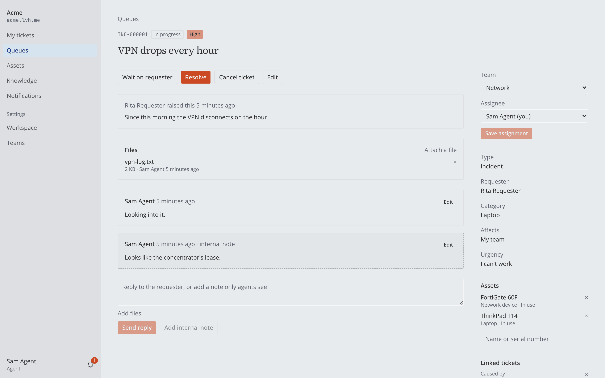</picture><br><b>An incident, as the agent sees it</b><br>Only the transitions its state allows are offered. The internal note is set visibly apart.</td>
    <td width="50%" valign="top"><picture><source media="(prefers-color-scheme: dark)" srcset="docs/screenshots/dark/requester-incident.png">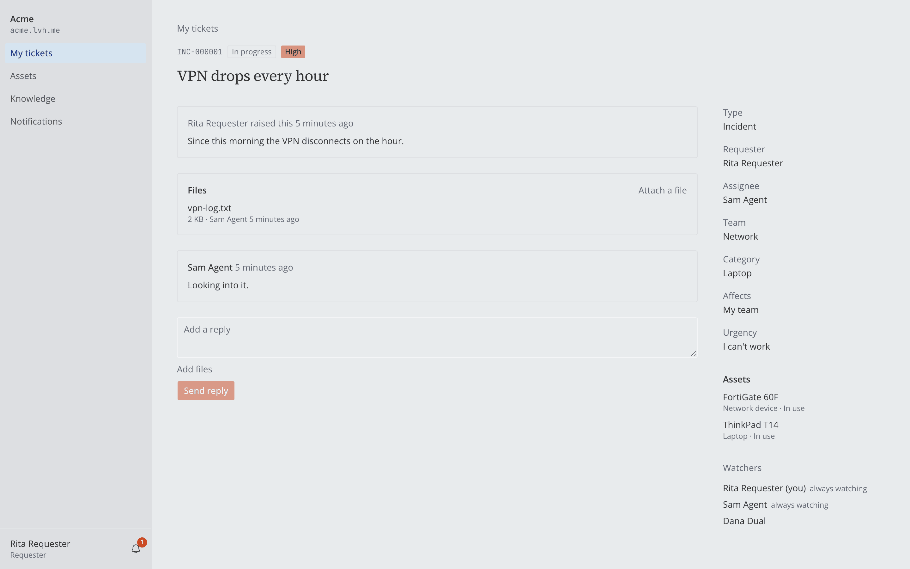</picture><br><b>The same incident, as the requester sees it</b><br>The reply is there. The internal note is not, because the API never sent it.</td>
  </tr>
</table>

### The requester's side

People who raise tickets get a portal, not a console, and can raise them by email just as well.

<table>
  <tr>
    <td width="50%" valign="top"><picture><source media="(prefers-color-scheme: dark)" srcset="docs/screenshots/dark/portal.png">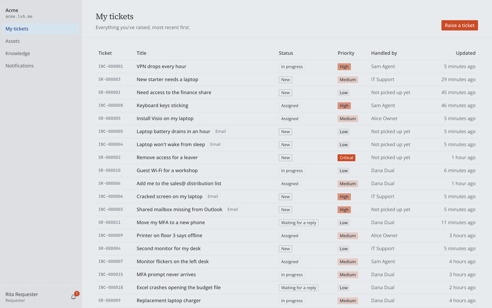</picture><br><b>The portal</b><br>Everything a requester raised, on the web or by mail, with the priority computed for them.</td>
    <td width="50%" valign="top"><picture><source media="(prefers-color-scheme: dark)" srcset="docs/screenshots/dark/new-ticket.png">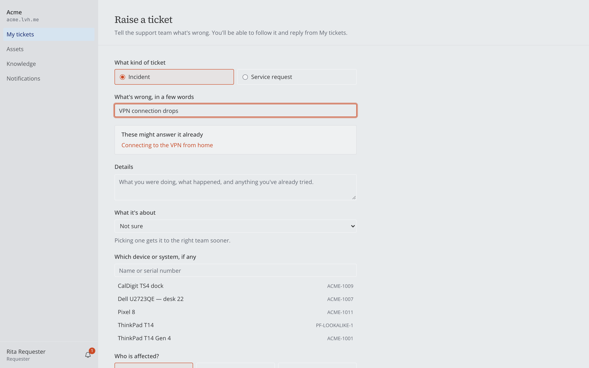</picture><br><b>Raising a ticket</b><br>There is no priority field. Impact and urgency decide it, and matching articles are suggested while typing.</td>
  </tr>
  <tr>
    <td width="50%" valign="top">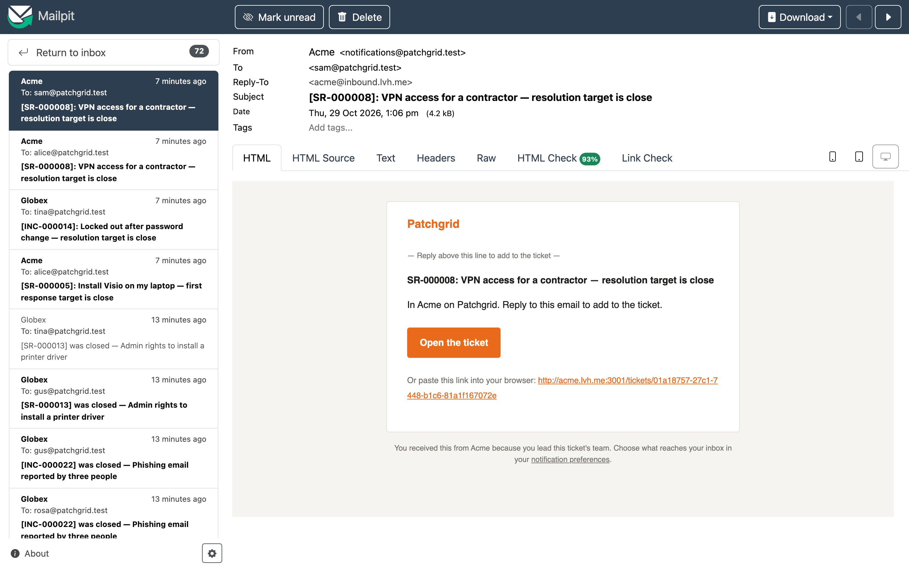<br><b>Notification mail</b><br>Sent at least once from a transactional outbox. A reply above the line threads onto the ticket.</td>
    <td width="50%" valign="top"><picture><source media="(prefers-color-scheme: dark)" srcset="docs/screenshots/dark/inbound.png">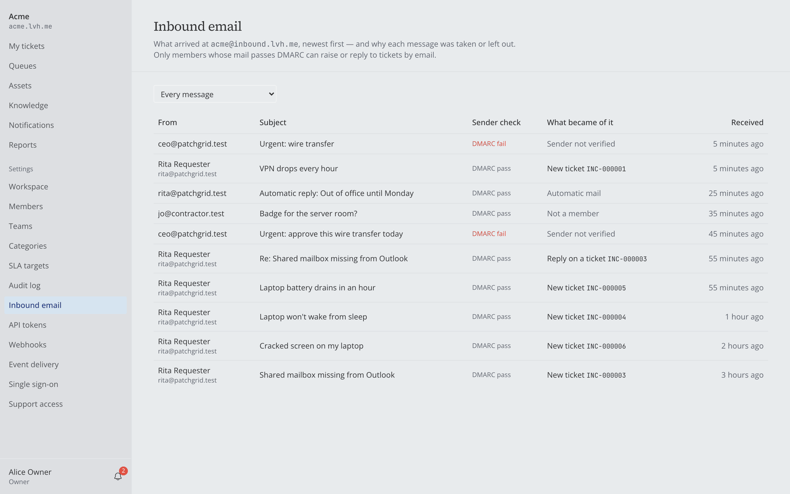</picture><br><b>Inbound mail</b><br>Mail to the workspace's address becomes a ticket only if the sender passes DMARC. Each message says what became of it.</td>
  </tr>
</table>

### Knowledge and assets

The context a ticket needs, in the same workspace and under the same isolation.

<table>
  <tr>
    <td width="50%" valign="top"><picture><source media="(prefers-color-scheme: dark)" srcset="docs/screenshots/dark/knowledge.png">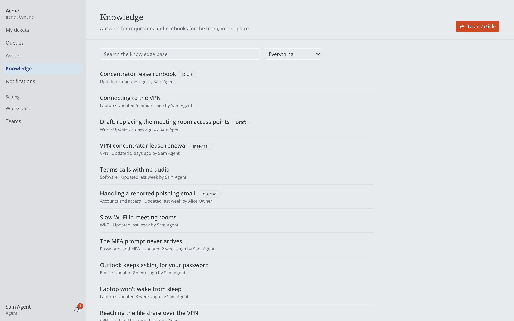</picture><br><b>The knowledge base</b><br>Published answers, internal runbooks and drafts, with every edit versioned.</td>
    <td width="50%" valign="top"><picture><source media="(prefers-color-scheme: dark)" srcset="docs/screenshots/dark/article.png">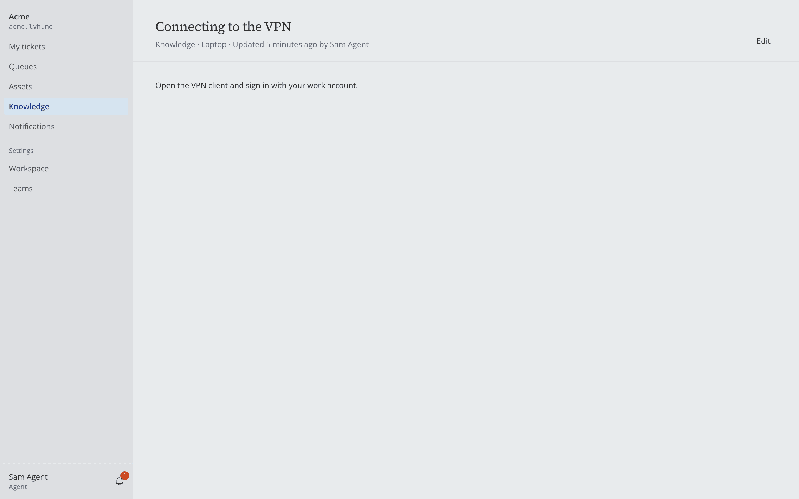</picture><br><b>An article</b><br>Requesters see published articles only; the server decides, never the page.</td>
  </tr>
  <tr>
    <td width="50%" valign="top"><picture><source media="(prefers-color-scheme: dark)" srcset="docs/screenshots/dark/assets.png">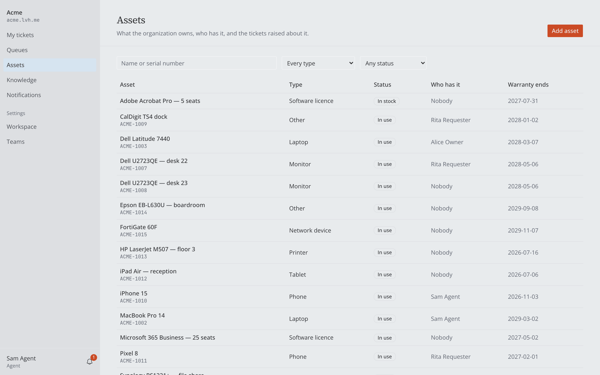</picture><br><b>The asset register</b><br>Laptops to licences: who holds what, its state and its warranty.</td>
    <td width="50%" valign="top"><picture><source media="(prefers-color-scheme: dark)" srcset="docs/screenshots/dark/asset.png">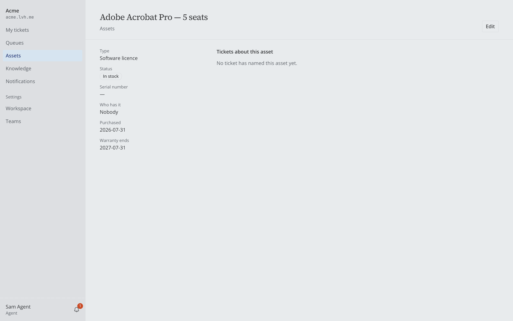</picture><br><b>An asset</b><br>With every ticket that has been about it.</td>
  </tr>
</table>

### Running a workspace

Everything an owner configures, under Settings. An agent who opens one gets “Nothing here”.

<table>
  <tr>
    <td width="50%" valign="top"><picture><source media="(prefers-color-scheme: dark)" srcset="docs/screenshots/dark/reports.png">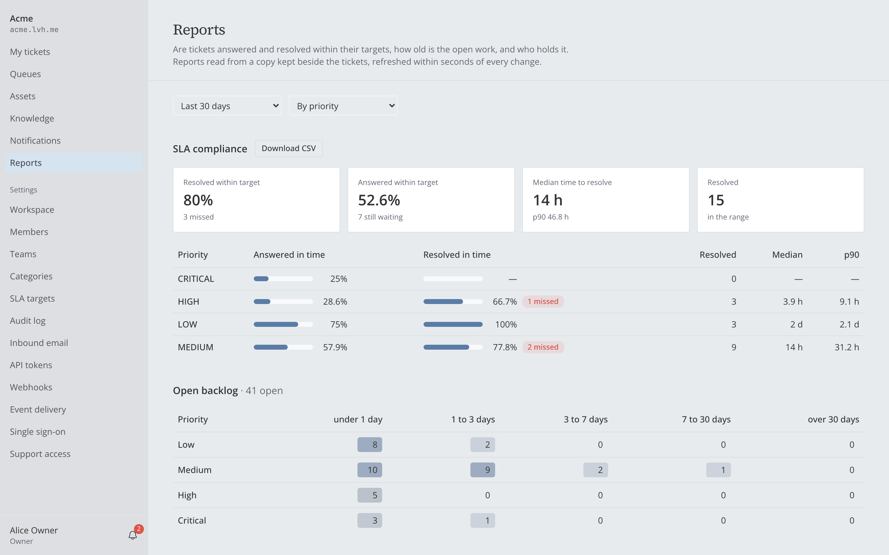</picture><br><b>Reports</b><br>SLA compliance, median and p90 time to resolve, backlog by age, CSV export. Read from a reporting model of their own.</td>
    <td width="50%" valign="top"><picture><source media="(prefers-color-scheme: dark)" srcset="docs/screenshots/dark/sla.png">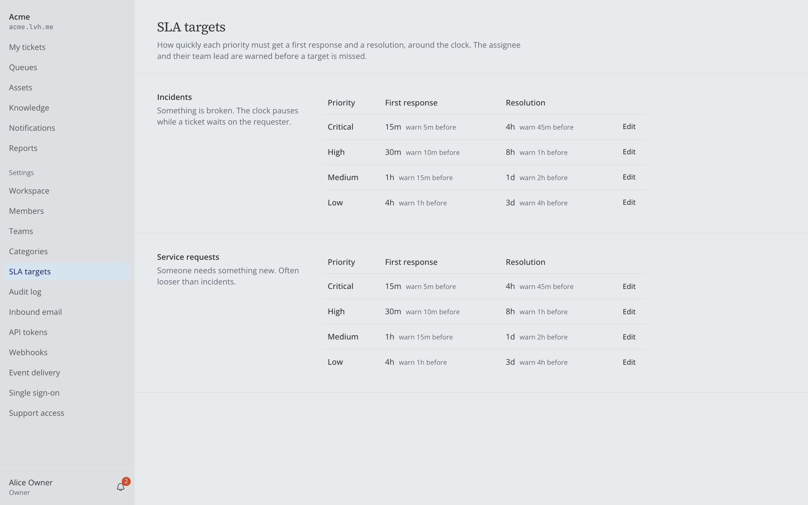</picture><br><b>SLA targets</b><br>Response and resolution targets per priority, running 24×7 and paused while waiting on the requester.</td>
  </tr>
  <tr>
    <td width="50%" valign="top"><picture><source media="(prefers-color-scheme: dark)" srcset="docs/screenshots/dark/members.png">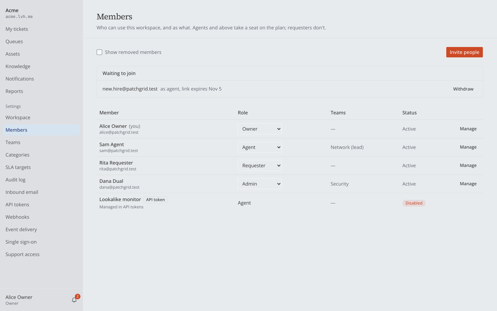</picture><br><b>Members</b><br>Invitations and roles. A role lives on the membership, never on the user.</td>
    <td width="50%" valign="top"><picture><source media="(prefers-color-scheme: dark)" srcset="docs/screenshots/dark/teams.png">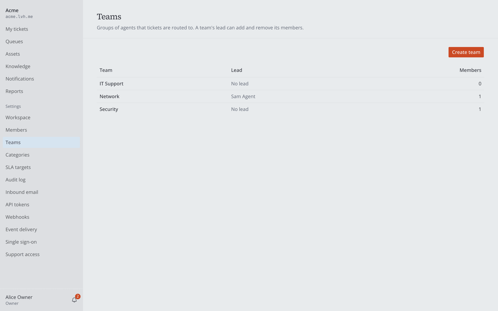</picture><br><b>Teams</b><br>An agent can be in several teams. Team lead is a scoped capability, not a role.</td>
  </tr>
  <tr>
    <td width="50%" valign="top"><picture><source media="(prefers-color-scheme: dark)" srcset="docs/screenshots/dark/categories.png">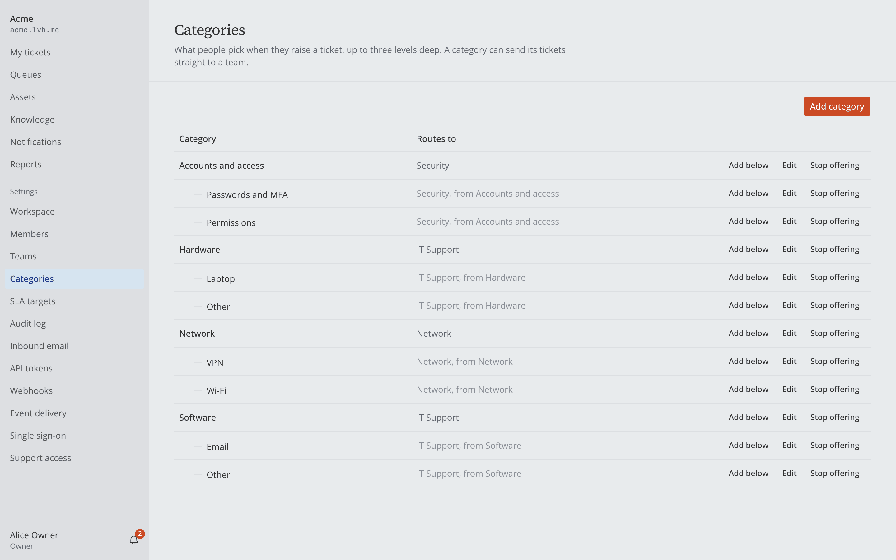</picture><br><b>Categories</b><br>A taxonomy that routes tickets to a team, with names unique per parent.</td>
    <td width="50%" valign="top"><picture><source media="(prefers-color-scheme: dark)" srcset="docs/screenshots/dark/settings.png">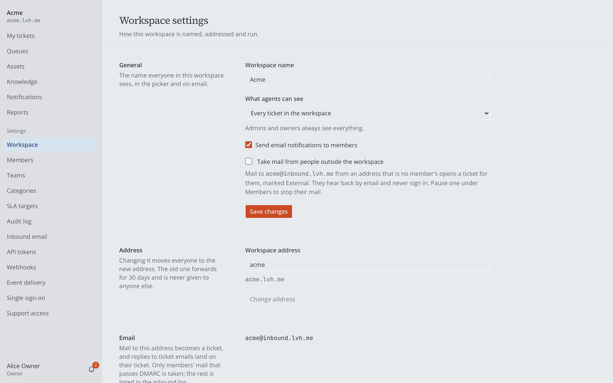</picture><br><b>Workspace settings</b><br>Agent visibility, external requesters, and the workspace's address.</td>
  </tr>
  <tr>
    <td width="50%" valign="top"><picture><source media="(prefers-color-scheme: dark)" srcset="docs/screenshots/dark/audit.png">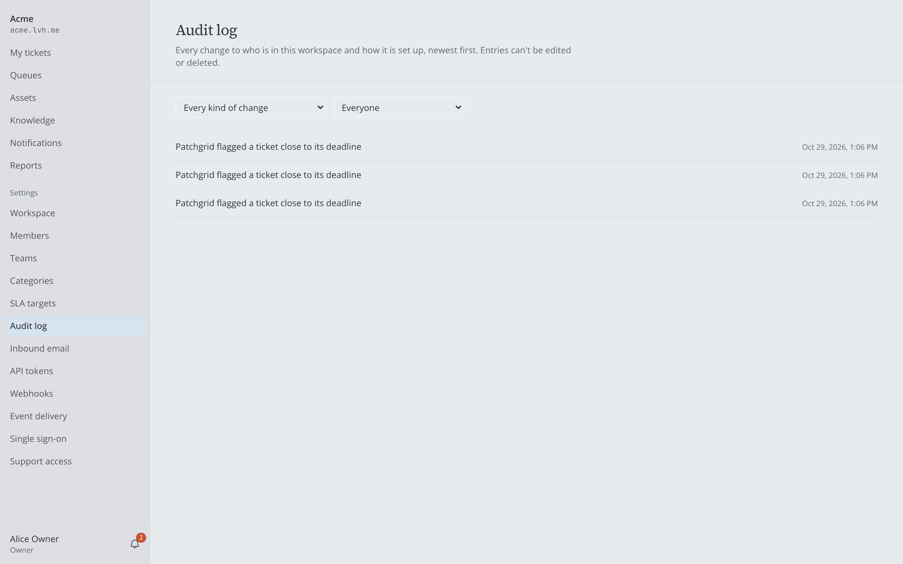</picture><br><b>The audit log</b><br>Every change, written in the same transaction as the change itself.</td>
    <td width="50%" valign="top"><picture><source media="(prefers-color-scheme: dark)" srcset="docs/screenshots/dark/events.png">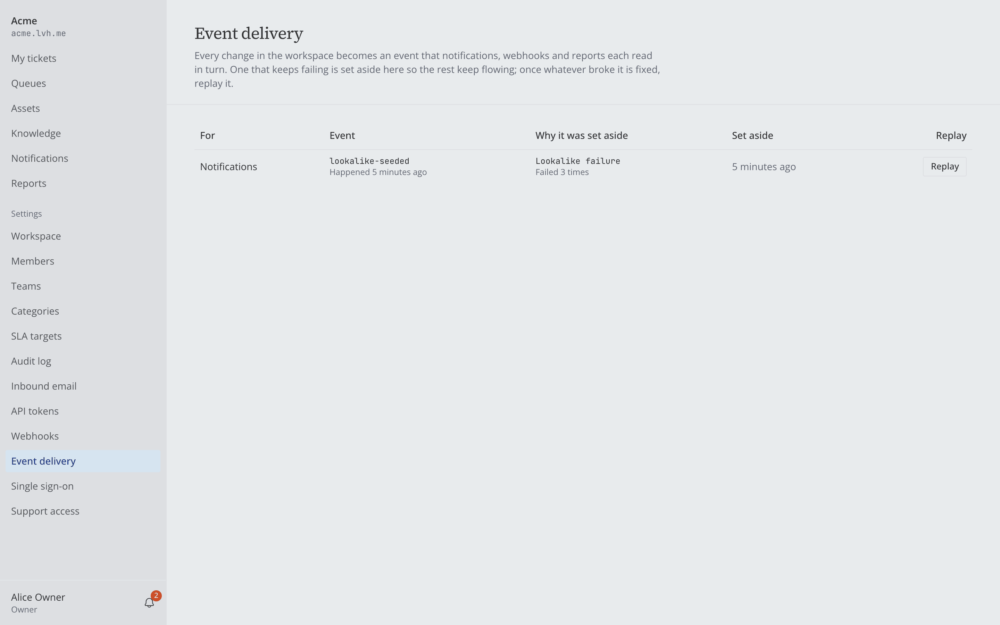</picture><br><b>Event delivery</b><br>Notifications, webhooks and reports each read the event log. An event that keeps failing is parked here to replay.</td>
  </tr>
  <tr>
    <td width="50%" valign="top"><picture><source media="(prefers-color-scheme: dark)" srcset="docs/screenshots/dark/api-tokens.png">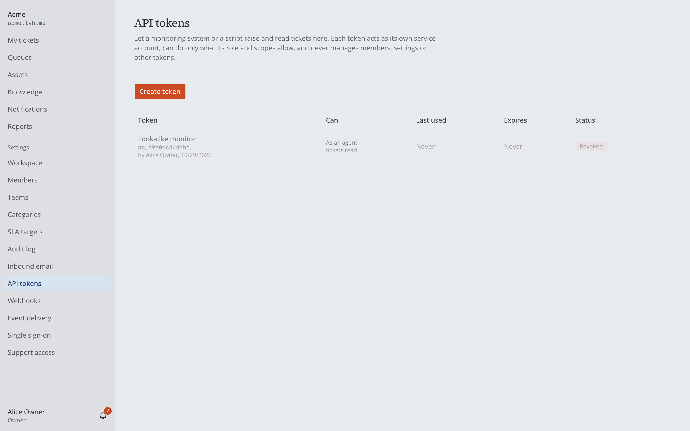</picture><br><b>API tokens</b><br>Each token is its own service account, and its scopes can never exceed its role.</td>
    <td width="50%" valign="top"><picture><source media="(prefers-color-scheme: dark)" srcset="docs/screenshots/dark/webhook.png">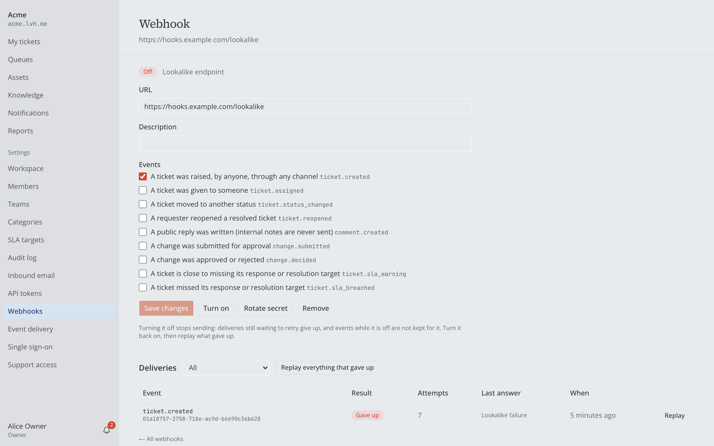</picture><br><b>A webhook</b><br>Standard Webhooks signatures, retries with backoff, a circuit breaker and a replayable delivery log.</td>
  </tr>
  <tr>
    <td width="50%" valign="top"><picture><source media="(prefers-color-scheme: dark)" srcset="docs/screenshots/dark/sso.png">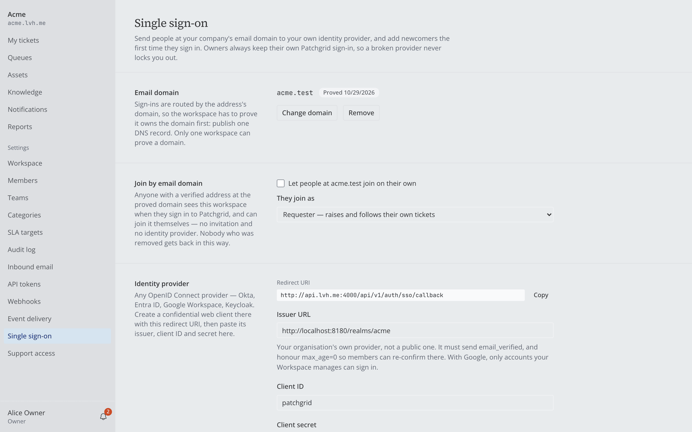</picture><br><b>Single sign-on</b><br>Prove the email domain over DNS, then connect the workspace's own OpenID Connect provider.</td>
    <td width="50%" valign="top"><picture><source media="(prefers-color-scheme: dark)" srcset="docs/screenshots/dark/support.png">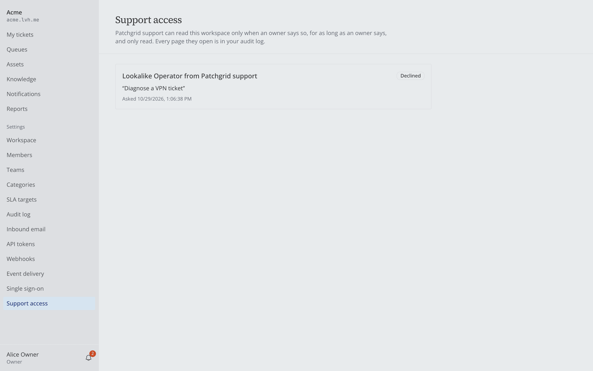</picture><br><b>Support access</b><br>Operators get in only when an owner grants it: read-only, time-boxed and in the customer's audit log.</td>
  </tr>
</table>

### Identity, tenancy and the platform

One person can belong to many companies. Each workspace is its own tenant, and the operators who run Patchgrid see none of their content.

<table>
  <tr>
    <td width="50%" valign="top"><picture><source media="(prefers-color-scheme: dark)" srcset="docs/screenshots/dark/login.png">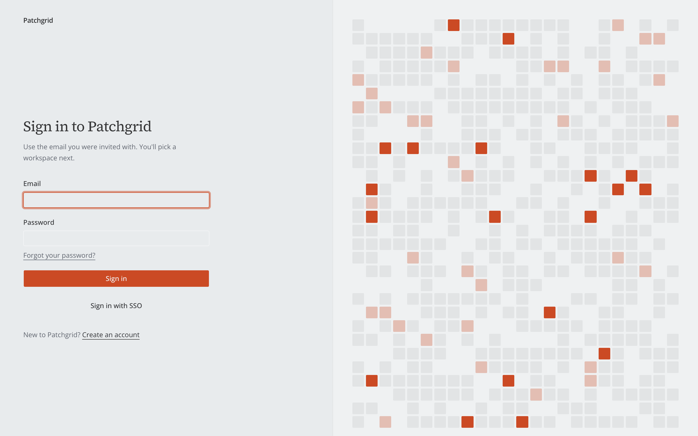</picture><br><b>Sign in</b><br>With a password and a second factor, a passkey, or the workspace's own SSO.</td>
    <td width="50%" valign="top"><picture><source media="(prefers-color-scheme: dark)" srcset="docs/screenshots/dark/workspaces.png">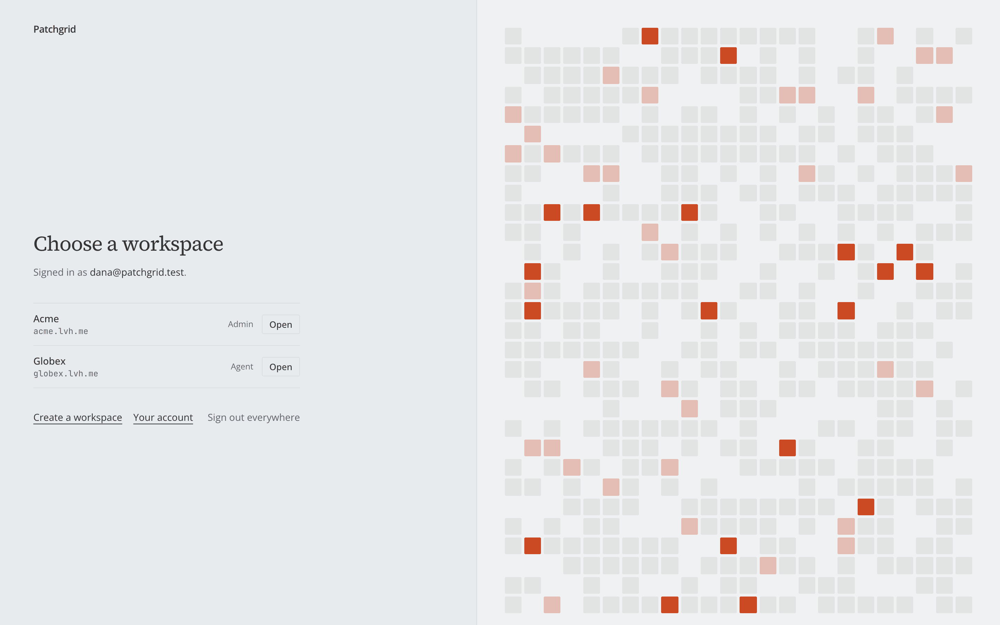</picture><br><b>The workspace picker</b><br>One account, many workspaces, a different role in each.</td>
  </tr>
  <tr>
    <td width="50%" valign="top"><picture><source media="(prefers-color-scheme: dark)" srcset="docs/screenshots/dark/dana-acme.png">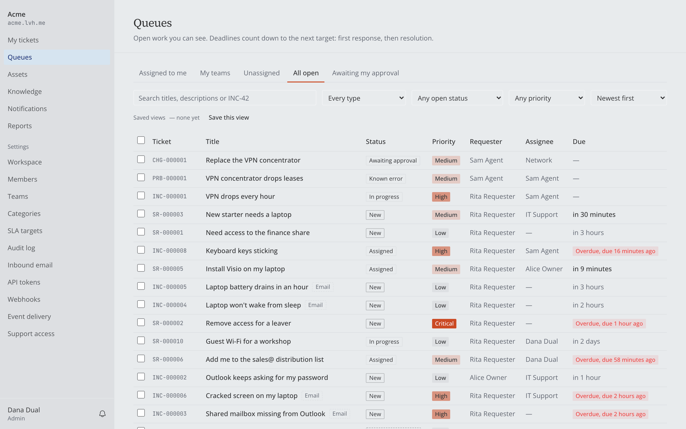</picture><br><b>Dana at Acme, as an admin</b><br>Each tab holds its own per-tenant session…</td>
    <td width="50%" valign="top"><picture><source media="(prefers-color-scheme: dark)" srcset="docs/screenshots/dark/dana-globex.png">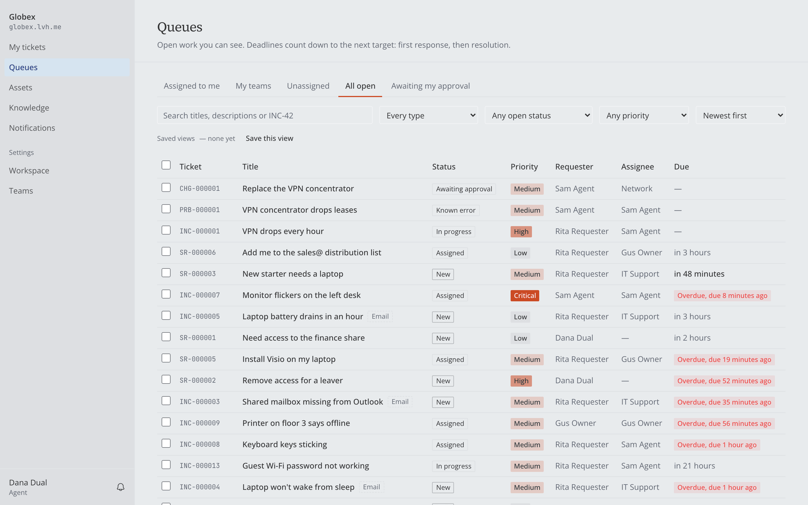</picture><br><b>Dana at Globex, as an agent</b><br>…and neither list ever shows the other company's tickets.</td>
  </tr>
  <tr>
    <td width="50%" valign="top"><picture><source media="(prefers-color-scheme: dark)" srcset="docs/screenshots/dark/account-security.png">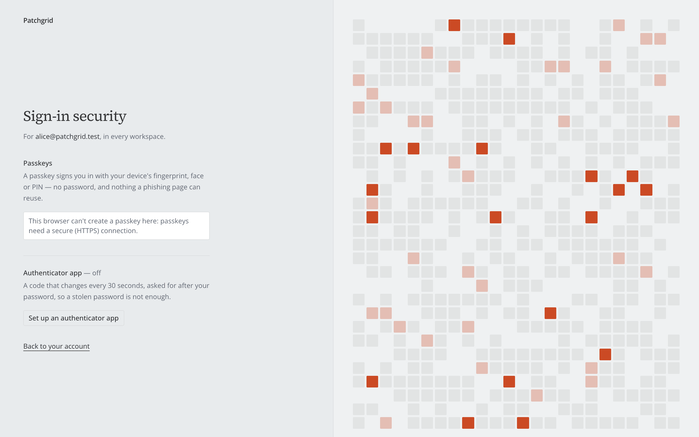</picture><br><b>Sign-in security</b><br>Passkeys and an authenticator app, and a fresh proof before anything irreversible.</td>
    <td width="50%" valign="top"><picture><source media="(prefers-color-scheme: dark)" srcset="docs/screenshots/dark/backoffice-mfa.png">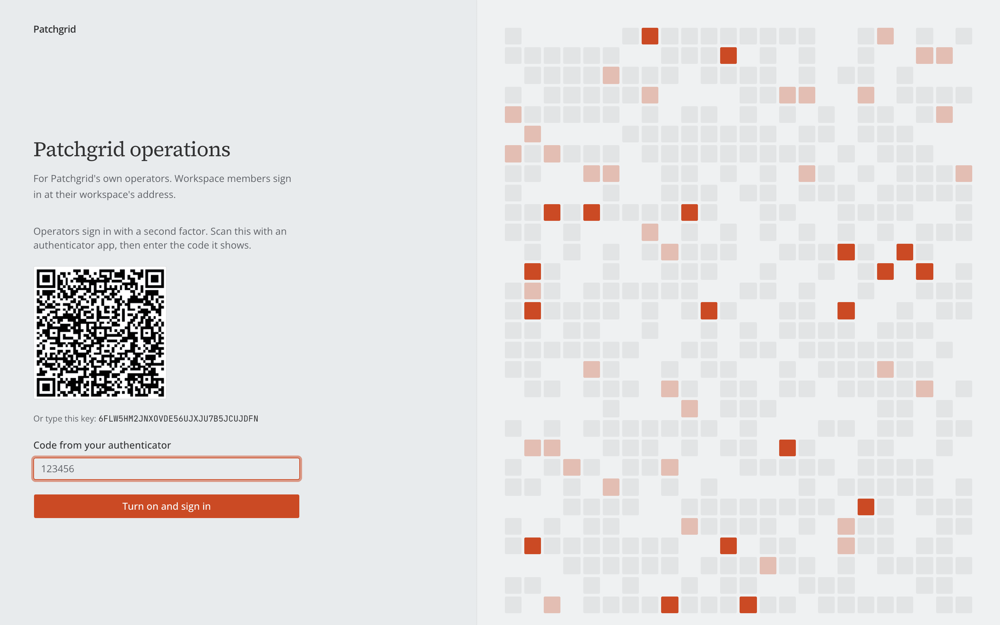</picture><br><b>The operators' sign-in</b><br>The back-office has its own credential and enrols a second factor on first use.</td>
  </tr>
  <tr>
    <td width="50%" valign="top"><picture><source media="(prefers-color-scheme: dark)" srcset="docs/screenshots/dark/backoffice.png">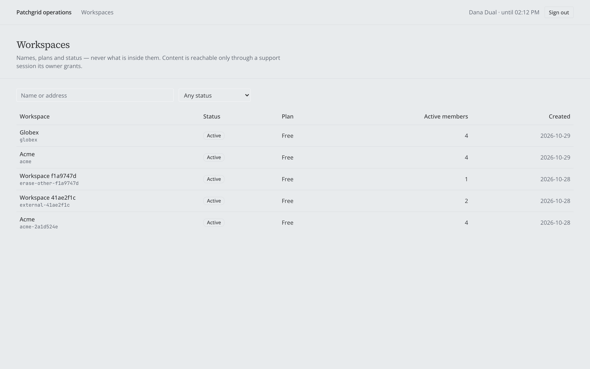</picture><br><b>The back-office</b><br>Workspace names, plans and status. Never what is inside them.</td>
    <td width="50%" valign="top"><picture><source media="(prefers-color-scheme: dark)" srcset="docs/screenshots/dark/backoffice-org.png">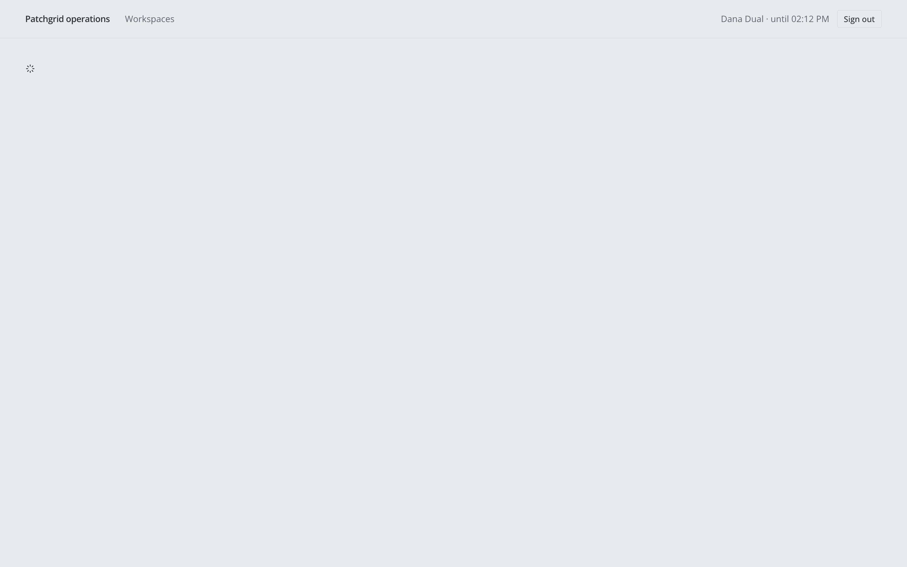</picture><br><b>A workspace, from the outside</b><br>Usage and lifecycle only. Content is reachable only through a support session its owner grants.</td>
  </tr>
</table>

### The public face

The marketing site is prerendered, with its own docs and an engineering blog. The API documents itself.

<table>
  <tr>
    <td width="50%" valign="top"><br><b>The landing page</b><br>The impact × urgency matrix, which is the whole pitch.</td>
    <td width="50%" valign="top">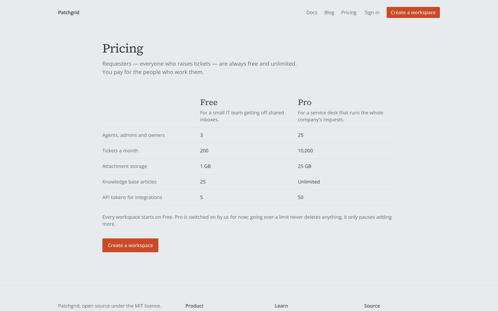402</code>."><br><b>Pricing</b><br>Requesters are free and unlimited. Plan limits are the only thing that ever answers <code>402</code>.</td>
  </tr>
  <tr>
    <td width="50%" valign="top">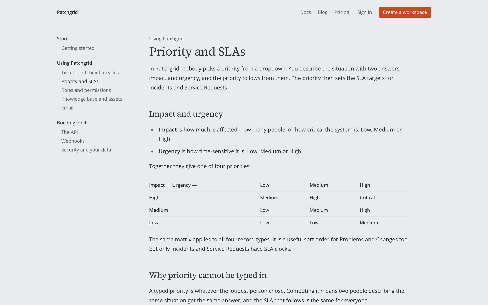<br><b>Product docs</b><br>How a workspace works, from creating one to building on its API.</td>
    <td width="50%" valign="top">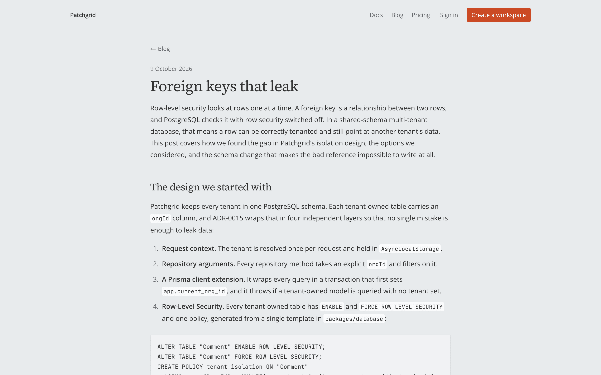<br><b>The engineering blog</b><br>Long-form write-ups of the decisions, such as the foreign keys that leak across tenants.</td>
  </tr>
  <tr>
    <td width="50%" valign="top">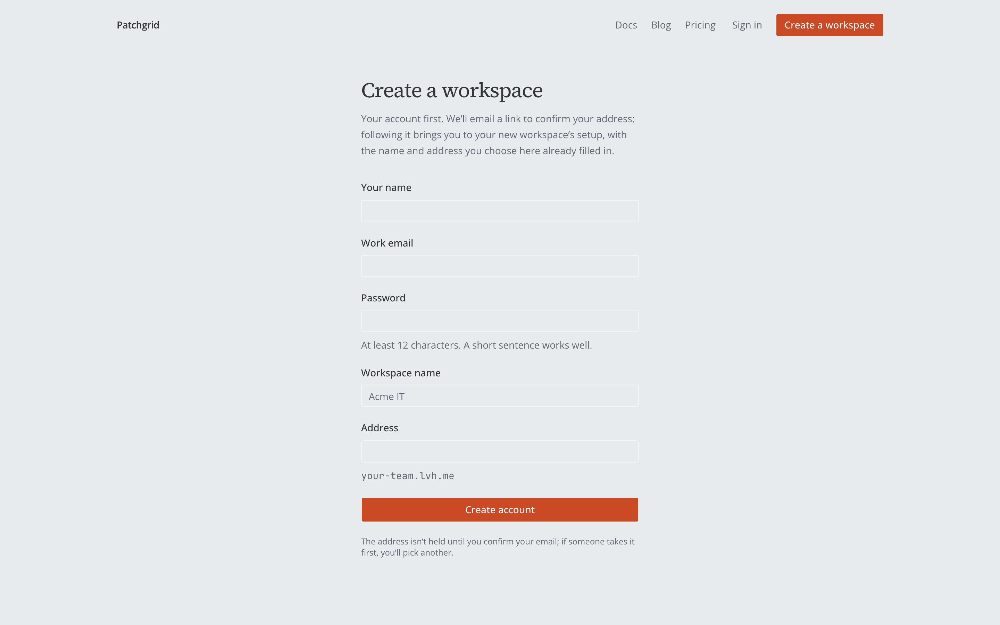<br><b>Signup</b><br>An account first. The emailed link verifies it and provisions the workspace on its own subdomain.</td>
    <td width="50%" valign="top">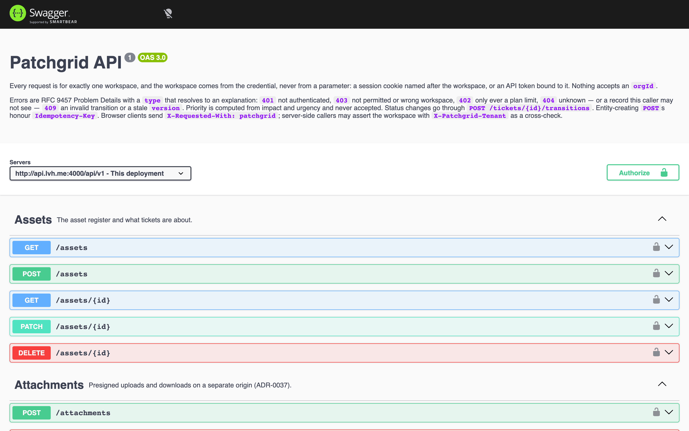<br><b>The API reference</b><br>OpenAPI generated from the same Zod contracts the apps use, with RFC 9457 errors throughout.</td>
  </tr>
</table>

## Run it in five minutes

You need **Node 24**, **pnpm 10** and **Docker**.

```bash
git clone https://github.com/KhaledSaeed18/patchgrid.git && cd patchgrid
pnpm install
pnpm local:up   # .env, containers, database roles, migrations, isolation checks, demo seed
pnpm dev        # www :3000 · app :3001 · api :4000
```

Then sign in at **http://app.lvh.me:3001**. Every password is `patchgrid-demo`.

| Account                | Who they are                                                                             |
| ---------------------- | ---------------------------------------------------------------------------------------- |
| `rita@patchgrid.test`  | Requester at Acme: the portal                                                            |
| `sam@patchgrid.test`   | Agent at Acme and lead of its Network team: the queues and change approvals              |
| `alice@patchgrid.test` | Owner of Acme: settings, reports, members, SSO                                           |
| `dana@patchgrid.test`  | Admin at Acme **and** agent at Globex; also the platform operator at `admin.lvh.me:3001` |
| `gus@patchgrid.test`   | Owner of Globex                                                                          |

`lvh.me` and all its subdomains resolve to `127.0.0.1`, so tenant subdomains work locally without
editing `/etc/hosts`.

<details>
<summary><b>A guided demo, in seven steps</b></summary>

<br>

1. **Raise a ticket as Rita.** She says what it affects and how urgent it is. The priority and both SLA
   deadlines are computed for her.
2. **Pick it up as Sam** in a second browser profile. His queue refreshes itself over Server-Sent Events,
   and assigning it to him raises an "assigned to you" toast. Reply, then add an internal note: Rita sees
   the reply and never the note.
3. **Mail a ticket in.** The script signs the message the way a receiving mail server would. Add
   `--dmarc fail` to watch a forged sender get refused:
   ```bash
   pnpm --filter @patchgrid/api run inbound:send -- --from rita@patchgrid.test --to acme --subject "Printer jammed"
   ```
   Outgoing mail lands in Mailpit at http://localhost:8025.
4. **Walk a change through approval.** As lead of Network, Sam finds changes waiting under "Awaiting my
   approval". A change's author is never offered its approval, so someone else has to decide.
5. **Look at it as the owner.** As Alice, under Settings: reports, the audit log, webhooks with their
   delivery log, API tokens, SLA targets and single sign-on.
6. **Be two companies at once.** Dana sees a workspace picker. Open Acme in one tab and Globex in the
   other. Each tab keeps its own session, and neither list ever shows the other's tickets.
7. **Try to cross the line.** Signed in only to Acme, open `http://globex.lvh.me:3001`. You are sent
   away, and the API answers `401` when Acme's cookies are presented to Globex. An agent who opens an
   admin page gets "Nothing here", and promoting anyone, themselves included, is a `403`.

</details>

Optional profiles add more of the system: `--profile sso` (Keycloak as Acme's identity provider),
`--profile observability` (traces and the per-tenant Grafana dashboard) and `--profile dns` (CoreDNS for
the domain proof). The [operations guide](docs/HANDOFF.md#running-it) has their setup.

## What it does

<table>
  <tr>
    <td width="50%" valign="top">

**Service desk**

- **Four record types, four lifecycles.** Incidents, service requests, problems (root cause, workaround,
  known errors) and changes (plan, risk, independent approval, recorded outcome), linked as _caused by_,
  _resolves_, _duplicate of_ or _relates to_.
- **Computed priority and SLA clocks.** Targets that run 24×7 and pause while the desk is waiting on the
  requester. A per-tenant sweep flags each warning and breach exactly once.
- **Queues, saved views and bulk actions** for up to two hundred tickets. Per-org numbering
  (`INC-000042`), routing by category, and full-text search.
- **Email intake.** Mail to `<slug>@inbound.<domain>` becomes a ticket and replies thread onto it, but
  only from senders who pass DMARC.
- **Context.** Attachments checked by their bytes, an asset register, and a versioned knowledge base.
- **Reports.** SLA compliance by priority, type, team, category or assignee, median and p90 time to
  resolve, and backlog by age, with CSV export.

</td>
    <td width="50%" valign="top">

**People and identity**

- **Workspaces and roles.** Self-service signup, invitations, cumulative roles on the membership, agents
  in several teams, and one person in many workspaces.
- **Strong authentication.** TOTP and passkeys, a workspace-wide "require MFA" switch, and step-up before
  anything irreversible.
- **Per-tenant single sign-on.** A workspace proves its domain over DNS and connects its own OpenID
  Connect provider. An SSO session opens that workspace and no other.

**Integration and operations**

- **Live notifications** over SSE and email, delivered at least once from a transactional outbox.
- **Webhooks** with Standard Webhooks signatures, retries, a circuit breaker and SSRF checks.
- **Scoped API tokens**, each its own service account.
- **A consent-only back-office.** Operators see metadata, never content, unless an owner grants a
  read-only, audited support session. There is no impersonation, ever.
- **Data protection**: a streamed export, account erasure, retention sweeps, and deletion with a 30-day
  grace period.

</td>
  </tr>
</table>

The [milestone-by-milestone scope](docs/FEATURES.md) says what each part delivered, and the
[product brief](docs/PROJECT.md#explicit-non-goals) lists what Patchgrid deliberately does not do.

## Architecture


| Host                   | Serves                                              |
| ---------------------- | --------------------------------------------------- |
| `patchgrid.xyz`        | Landing, pricing, docs, blog, signup                |
| `<slug>.patchgrid.xyz` | A tenant's workspace: the product                   |
| `app.patchgrid.xyz`    | Tenant-less: login, workspace picker, new workspace |
| `admin.patchgrid.xyz`  | The operators' back-office                          |
| `api.patchgrid.xyz`    | NestJS: all business logic and data access          |

- **The frontends hold no data access.** Server components call the API over HTTP like any other client,
  so tenancy, authorization, SLA math and auditing live in exactly one place.
- **The API is layered** Controller → Service → Repository, and lint enforces it: only repositories import
  Prisma, and only four modules may touch the request context.
- **One image, two roles.** The same API image serves HTTP or runs the BullMQ workers, depending on
  `WORKER_MODE`.
- **Contracts are shared, not generated.** Zod schemas in `packages/contracts` define every wire shape
  once, for all three apps and for the OpenAPI document.

**Go deeper:** [the architecture](docs/ARCHITECTURE.md) covers the request pipeline, data model,
background jobs and integration boundaries. [DNS and email](docs/DNS.md) covers hostnames, wildcard TLS
and mail authentication.

## Engineering highlights

### Tenant isolation, in five layers

This is what the project is really about. Each layer catches a mistake the others would let through.

| #   | Layer                    | What it does                                                                                                                                                                                                                                                                    |
| --- | ------------------------ | ------------------------------------------------------------------------------------------------------------------------------------------------------------------------------------------------------------------------------------------------------------------------------- |
| 0   | **Schema shape**         | Foreign keys between tenant tables are composite on `(orgId, id)`. Postgres checks foreign keys with row security _off_, so this is the only layer that makes a cross-tenant reference [impossible to write](docs/decisions/0023-identity-keys-and-tenant-safe-foreign-keys.md) |
| 1   | **Request context**      | The tenant comes from the credential, [never from the `Host`](docs/decisions/0024-per-tenant-cookies-and-api-tenant-resolution.md) or a request field. The origin is only a cross-check                                                                                         |
| 2   | **Repository arguments** | Every repository method takes an explicit `orgId` and filters on it                                                                                                                                                                                                             |
| 3   | **Prisma extension**     | A transaction-local `set_config` before every query, and an error if there is no tenant context                                                                                                                                                                                 |
| 4   | **Postgres RLS**         | [A policy on every tenant table](docs/decisions/0015-tenant-isolation-rls.md), and an app role with no `BYPASSRLS` that `db:doctor` asserts is not a member of the table owner                                                                                                  |

The same rule holds for work outside a request. Background jobs carry their `orgId` and run inside that
tenant, and sweeps fan out one job per tenant instead of one global scan. The live stream sends a ticket
event only to members who could open that ticket, and a test holds that decision equal to the one the
ticket page makes. **Go deeper:** [the tenancy model](docs/TENANCY.md) and
[authorization within a tenant](docs/RBAC.md).

### Decisions worth reading

Every significant choice has a record of its context, the options considered and why one won. These
shape the system the most:

| Decision                                            | Why                                                                                              | Read                                                                                                                                                       |
| --------------------------------------------------- | ------------------------------------------------------------------------------------------------ | ---------------------------------------------------------------------------------------------------------------------------------------------------------- |
| Shared schema + RLS + composite keys                | Not a database per tenant, and not RLS alone                                                     | [Isolation](docs/decisions/0015-tenant-isolation-rls.md) · [Tenant-safe keys](docs/decisions/0023-identity-keys-and-tenant-safe-foreign-keys.md)           |
| Authorization in the service, on a resolved subject | A pure `can()`, deny by default. Reads you may not see are `404`, actions you may not take `403` | [RBAC](docs/decisions/0019-rbac-model-and-enforcement.md)                                                                                                  |
| Per-type state machines, one transition endpoint    | Status changes only through `POST /tickets/:id/transitions`                                      | [State machines](docs/decisions/0002-per-type-state-machines-and-extension-tables.md) · [Transitions](docs/decisions/0006-explicit-transition-endpoint.md) |
| A transactional outbox, read as a per-tenant log    | Side effects written in the change's own transaction, so nothing is lost, repeated or skipped    | [Outbox](docs/decisions/0049-transactional-outbox-as-a-tenant-log.md)                                                                                      |
| Reports from a read model of their own              | One fact row per ticket, refreshed from the log and reconciled nightly                           | [Reporting](docs/decisions/0051-reporting-read-side.md)                                                                                                    |
| Webhooks nobody else pays for                       | Thin signed events, a circuit with one probe, a per-tenant in-flight cap                         | [Webhooks](docs/decisions/0050-outbound-webhooks.md)                                                                                                       |
| Files on their own registrable domain               | User content never shares a site, or cookies, with the app                                       | [Attachments](docs/decisions/0037-attachments-on-their-own-registrable-domain.md) · [Staging](docs/decisions/0038-uploads-land-in-staging.md)              |
| Mail trusted on its verdict                         | Only DMARC-passing senders raise tickets, whatever name the `From:` line gives                   | [Inbound mail](docs/decisions/0039-inbound-mail-feed-and-verdict.md)                                                                                       |
| No impersonation                                    | Operators read a workspace only in an owner-granted, read-only, audited session                  | [Support access](docs/decisions/0020-consent-based-support-access.md)                                                                                      |
| Passkeys and per-tenant SSO                         | An identity provider vouches for its own workspace only                                          | [Passkeys](docs/decisions/0053-passkeys.md) · [SSO](docs/decisions/0054-per-tenant-oidc-sso.md)                                                            |

[All 59 decisions](docs/decisions/README.md) come with a suggested reading order. Four longer write-ups
are on the engineering blog:
[foreign keys that leak](apps/www/content/blog/foreign-keys-that-leak.mdx),
[the tenant comes from the credential](apps/www/content/blog/the-tenant-comes-from-the-credential.mdx),
[priority is computed](apps/www/content/blog/priority-is-computed.mdx) and
[what a security review found](apps/www/content/blog/what-a-security-review-found.mdx).

### Observability that names the tenant

OpenTelemetry traces and metrics carry a bounded tenant label, so "the app is slow" becomes "one tenant's
queue is slow". The dashboard below comes from the same demo, with one workspace deliberately browsing
five times harder than the other.

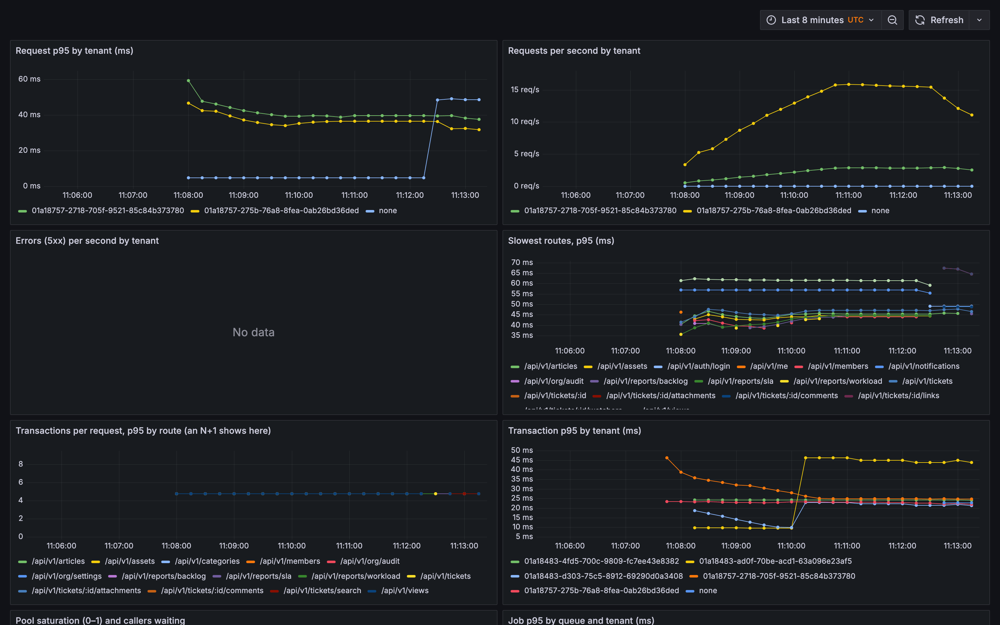

### Security

A [threat model](docs/THREAT-MODEL.md) with thirteen trust boundaries and STRIDE per boundary, plus five
security reviews. Each finding is recorded with its fix, or with the reason it was accepted. To report a
vulnerability, see the [security policy](SECURITY.md).

### Quality gates

| Suite                 | What it proves                                                                                        |
| --------------------- | ----------------------------------------------------------------------------------------------------- |
| `pnpm test`           | 1,550+ unit tests: transitions, priority, SLA math, permissions, quotas, contracts                    |
| `pnpm test:tenancy`   | The schema catalog (every tenant table has its policy, keys and indexes) and the isolation suite      |
| `pnpm test:authz`     | The permission matrix cell by cell, and that every route asserts a permission or is explicitly public |
| `test:integration`    | 300+ specs against real Postgres, Redis, MinIO and queues                                             |
| `test:e2e`            | A Playwright suite across two tenants, built around the negative cases                                |
| `pnpm aws:run verify` | The isolation suite again, from inside the VPC, through PgBouncer                                     |

CI also enforces lint with zero warnings and the architectural import boundaries, checks for schema
drift, asserts the database roles, scans the full history for secrets, runs CodeQL, builds all three
images, and smoke-tests the whole stack. Time is injected through a `Clock`, so no test sleeps.
**Go deeper:** [the engineering conventions](docs/ENGINEERING.md).

### A production rehearsal on emulated AWS

Patchgrid is [deliberately not hosted publicly](docs/decisions/0047-no-public-deployment.md). Instead,
the production deployment is [rehearsed for real](docs/decisions/0058-production-rehearsal-on-emulated-aws.md)
on [Floci](https://floci.io/floci/), an AWS emulator, and provisioned by OpenTofu from modules written for
real AWS:

```bash
pnpm aws:up            # Floci, the platform, then build → push to ECR → migrate → roll → healthy
pnpm aws:run verify    # the tenancy suite inside the VPC, through PgBouncer
pnpm aws:e2e           # the browser suite through the HTTPS load balancer, passkeys included
pnpm aws:down
```

That covers ECS services behind an ALB with an ACM wildcard certificate, RDS PostgreSQL 17 with roles RDS
itself could create, ElastiCache with TLS and AUTH, S3, SES, and Secrets Manager under KMS. CI deploys all
of it from nothing on every change to `main`. **Go deeper:** [the rehearsal runbook](infra/README.md),
including every place Floci differs from AWS.

## Tech stack

| Concern              | Choice                                                                                            |
| -------------------- | ------------------------------------------------------------------------------------------------- |
| Language and tooling | TypeScript (strict, no `any`) · Node 24 · pnpm 10 · Turborepo                                     |
| Frontends            | Next.js 16 (App Router) · React 19 · Tailwind CSS 4 · shadcn/ui                                   |
| Backend              | NestJS 11 · Zod 4 contracts shared through `packages/contracts`                                   |
| Data                 | PostgreSQL 17 with row-level security · Prisma 7 · Redis 7 + BullMQ                               |
| Files and mail       | S3 (MinIO locally) · SMTP (Mailpit locally) or SES                                                |
| Identity             | Argon2id · JWT access + rotating refresh in per-tenant cookies · TOTP · WebAuthn · OpenID Connect |
| Observability        | OpenTelemetry · Tempo · Prometheus · Grafana · pino                                               |
| Testing              | Vitest · Playwright · real Postgres for integration                                               |
| Infrastructure       | Docker · OpenTofu · Floci (ECS, ALB, RDS, ElastiCache, S3, SES, KMS) · GitHub Actions             |

## Repository layout

```
apps/
  www/              Marketing site, docs and blog (Next.js)
  app/              The tenant workspace, the tenant-less entry and the back-office (Next.js)
  api/              NestJS: HTTP API, background workers, mail, webhooks
packages/
  database/         Prisma schema, migrations, hand-written RLS policies, the role bootstrap, the seed
  contracts/        Zod schemas for every request and response, the permission catalog, limits
  ui/               Shared shadcn components and design tokens
  eslint-config/    Lint rules, including the architectural import zones
  typescript-config/
infra/              OpenTofu modules and roots for the AWS rehearsal, and its runbook
docker/             Local service configuration: MinIO, Keycloak, CoreDNS, observability
docs/               The specification, the threat model, the decision records, the screenshots
scripts/            local:up and the aws:* commands
```

## Documentation

The documentation is the specification. It was written before the code and is kept true as the code
changes: a change to a rule ships in the same pull request as the code that implements it.

<table>
  <tr>
    <td width="33%" valign="top">

**The product**

- [Product brief](docs/PROJECT.md): what it is, and what it is not
- [Domain rules](docs/DOMAIN.md): lifecycles, priority, SLA clocks
- [Scope and milestones](docs/FEATURES.md)
- [Where things stand](docs/HANDOFF.md)

</td>
    <td width="33%" valign="top">

**Architecture**

- [System architecture](docs/ARCHITECTURE.md)
- [Tenancy and isolation](docs/TENANCY.md)
- [Authorization](docs/RBAC.md)
- [DNS, TLS and email](docs/DNS.md)
- [The AWS rehearsal](infra/README.md)

</td>
    <td width="33%" valign="top">

**Reasoning and practice**

- [Architecture decisions](docs/decisions/README.md)
- [Threat model and reviews](docs/THREAT-MODEL.md)
- [Engineering conventions](docs/ENGINEERING.md)
- [The browser suite](apps/app/e2e/README.md)

</td>
  </tr>
</table>

The [documentation hub](docs/README.md) groups every document by the question it answers and suggests
reading paths: fifteen minutes to evaluate the project, or the full route through tenant isolation.

## Status

**Complete.** All planned milestones are built and verified. The machine-learning and automation-engine
milestone was [dropped on purpose](docs/decisions/0056-m7-dropped.md). For what a real deployment would
still need, see [where things stand](docs/HANDOFF.md).

## Contributing, security and license

This is a personal portfolio project and is not looking for feature contributions. The
[contributing guide](CONTRIBUTING.md) explains the conventions the repository enforces, which are worth
knowing if you read or run the code. Report vulnerabilities through the [security policy](SECURITY.md).

Released under the [MIT license](LICENSE). This repository is meant to be read.
