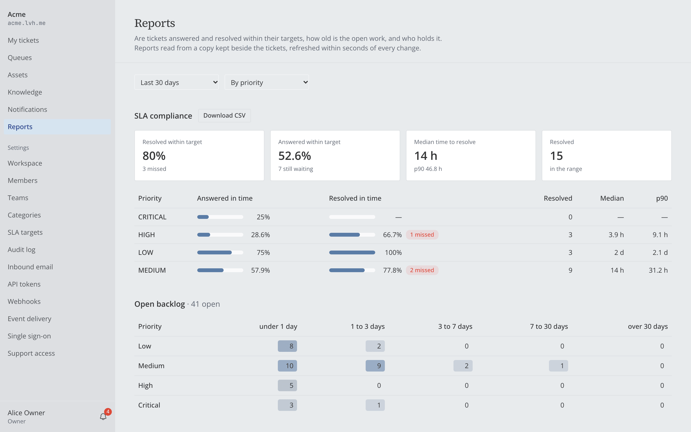
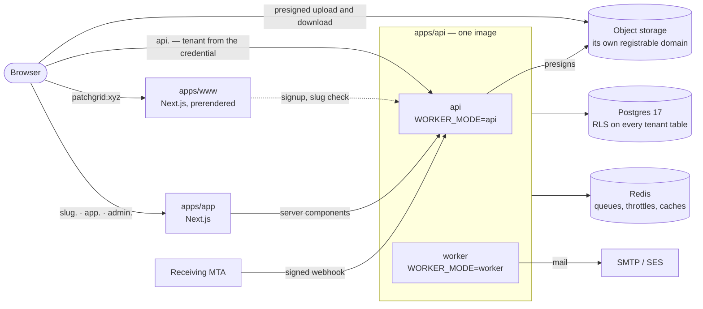

<div align="center">

# Patchgrid

**Multi-tenant IT service management, built the way a production SaaS has to be.**

Incidents, service requests, problems and changes for IT and security teams, with every company on
its own subdomain and its data isolated by the database itself.

[](https://github.com/KhaledSaeed18/patchgrid/actions/workflows/ci.yml)
[](https://github.com/KhaledSaeed18/patchgrid/actions/workflows/aws.yml)
[](https://github.com/KhaledSaeed18/patchgrid/actions/workflows/codeql.yml)
[](LICENSE)
[](.nvmrc)

[The demo](#try-it-in-five-minutes) · [Architecture](#architecture-in-one-picture) ·
[Engineering highlights](#engineering-highlights) · [Documentation](docs/README.md) ·
[Decisions](docs/decisions/README.md)


</div>

---

## What it is

Patchgrid is a ticketing and operations platform for internal IT desks: a scoped-down Freshservice or
Jira Service Management. It is a portfolio and learning project, but it is built as if it were going
to production. There are three deployables and a tenant per subdomain. Isolation is enforced in the
schema, the application and Postgres row-level security. The design behind it is written down in
59 architecture decision records.

Three ideas run through the whole system:

- **An incident is not a change.** Patchgrid models four ITIL record types, each with its own
  lifecycle, instead of one generic "ticket" with a status dropdown.
- **Nobody types a priority.** Priority is computed from impact × urgency, and the SLA deadlines follow
  from it. A client that sends one gets a `400`.
- **Isolation is a property of the schema, not a habit.** A cross-tenant reference cannot be written,
  and the application's database role cannot bypass row-level security.

|                   |                                                                                                           |
| ----------------- | --------------------------------------------------------------------------------------------------------- |
| **Record types**  | Incident · Service request · Problem · Change, each with its own state machine                            |
| **Deployables**   | `www` (Next.js marketing) · `app` (Next.js workspace) · `api` (NestJS, API and workers)                   |
| **Isolation**     | 5 layers, from composite foreign keys to `FORCE ROW LEVEL SECURITY`, gated by a dedicated suite           |
| **Authorization** | 4 cumulative roles, team leads as a scoped capability, a 400-test authorization suite in CI               |
| **Tests**         | 2,300+ automated: unit, integration on real Postgres and Redis, tenancy, authz, browser                   |
| **Deployment**    | A production rehearsal on emulated AWS (ECS, ALB, RDS, ElastiCache, S3, SES), deployed from nothing in CI |
| **Decisions**     | [59 ADRs](docs/decisions/README.md), each with the alternatives it beat                                   |

## A tour

|                                                                                                                  |                                                                                                              |
| ---------------------------------------------------------------------------------------------------------------- | ------------------------------------------------------------------------------------------------------------ |
|                                      |  |
| **The marketing site.** Signup provisions a workspace on its own subdomain.                                      | **An incident.** Only the transitions its state allows are offered; internal notes are visibly apart.        |
|  |             |
| **The requester portal.** Tickets raised on the web or by email, priority computed for them.                     | **A change.** A plan, a risk, and an approval by someone other than its author.                              |
|                      |             |
| **Reports.** SLA compliance, time to resolve, backlog by age, read from a model of their own.                    | **The knowledge base.** Drafts, internal runbooks and published answers, suggested as a requester types.     |

## Try it in five minutes

You need **Node 24**, **pnpm 10** and **Docker**.

```bash
git clone https://github.com/KhaledSaeed18/patchgrid.git && cd patchgrid
pnpm install
pnpm local:up   # .env, containers, database roles, migrations, isolation checks (6/6), demo seed
pnpm dev        # www :3000 · app :3001 · api :4000
```

Then sign in at **http://app.lvh.me:3001**. Every password is `patchgrid-demo`.

| Account                | Who they are                                                                             |
| ---------------------- | ---------------------------------------------------------------------------------------- |
| `rita@patchgrid.test`  | Requester at Acme: the portal                                                            |
| `sam@patchgrid.test`   | Agent at Acme, lead of the Network team: the queues and change approvals                 |
| `alice@patchgrid.test` | Owner of Acme: settings, reports, members, SSO                                           |
| `dana@patchgrid.test`  | Admin at Acme **and** agent at Globex; also the platform operator at `admin.lvh.me:3001` |
| `gus@patchgrid.test`   | Owner of Globex                                                                          |

`lvh.me` and every subdomain of it resolve to `127.0.0.1`, so tenant subdomains work locally with no
`/etc/hosts` changes.

### A guided demo

1. **Raise a ticket as Rita.** She says what it affects and how urgent it is. The priority and both
   SLA deadlines are computed for her.
2. **Pick it up as Sam** in a second browser profile. His queue refreshes itself over Server-Sent
   Events, and assigning it to him raises an "assigned to you" toast. Reply, then add an internal note:
   Rita sees the reply and never the note.
3. **Mail a ticket in.** The script signs the message as a receiving mail server would. Add
   `--dmarc fail` to watch a forged sender get refused:
   ```bash
   pnpm --filter @patchgrid/api run inbound:send -- --from rita@patchgrid.test --to acme --subject "Printer jammed"
   ```
   Outgoing notifications land in Mailpit at http://localhost:8025.
4. **Walk a change through approval.** As lead of Network, Sam finds changes waiting under "Awaiting my
   approval". A change's author is never offered its approval, so someone else has to decide.
5. **Look at it as the owner.** As Alice: reports, the audit log, webhooks with their delivery log,
   API tokens, SLA targets and single sign-on, all under Settings.
6. **Be two companies at once.** Dana sees a workspace picker. Open Acme in one tab and Globex in the
   other; each tab keeps its own session, and neither list ever shows the other's tickets.
7. **Try to cross the line.** Signed in only to Acme, open `http://globex.lvh.me:3001`. You are sent
   away, and the API answers `401` to Acme's cookies asked as Globex. An agent opening an admin page
   gets "Nothing here", and promoting anyone, themselves included, is a `403`.

Optional profiles add more of the system: `--profile sso` (Keycloak as Acme's identity provider),
`--profile observability` (traces and a per-tenant Grafana dashboard) and `--profile dns` (CoreDNS for
the domain proof). Their setup is in [`docs/HANDOFF.md`](docs/HANDOFF.md#running-it).

## What it does

**Service desk**

- **Four record types, four lifecycles.** Incidents, service requests, problems (root cause,
  workaround, known errors) and changes (plan, risk, independent approval, recorded outcome). Tickets
  link to each other as caused by, resolves, duplicate of or relates to.
- **Computed priority and SLA clocks.** Response and resolution targets that run 24×7 and pause while
  waiting on the requester. A per-tenant sweep flags warnings and breaches once each, and resolved
  tickets close themselves after seven days.
- **Queues, saved views and bulk actions** for up to two hundred tickets, each ticket answering for
  itself. Per-org numbering (`INC-000042`), routing by category, and full-text search.
- **Email intake.** Mail to `<slug>@inbound.<domain>` becomes a ticket, and replies thread onto it,
  but only from senders who pass DMARC. External requesters are supported as an opt-in.
- **Context.** Attachments uploaded straight to object storage and checked by their bytes, an asset
  register (laptops to licences), and a knowledge base with versioned articles.
- **Reports.** SLA compliance by priority, type, team, category or assignee, median and p90 time to
  resolve, backlog by age and workload, with CSV export.

**People and identity**

- **Workspaces and roles.** Self-service signup and provisioning, invitations, roles on the membership
  (`REQUESTER ⊂ AGENT ⊂ ADMIN ⊂ OWNER`), agents in several teams, team leads, and one person in many
  workspaces through a picker.
- **Strong authentication.** TOTP and passkeys, a workspace-wide "require MFA" switch, and a fresh
  proof (step-up) before anything irreversible.
- **Per-tenant single sign-on.** A workspace proves its email domain by DNS and connects its own
  OpenID Connect provider. Members are provisioned on first sign-in, and an SSO session opens that
  workspace and no other.

**Integration and operations**

- **Live notifications**: an inbox, a bell, live updates over SSE, and email with per-member
  preferences, delivered at least once from a transactional outbox.
- **Webhooks**: Standard Webhooks signatures, retries with backoff, a circuit breaker, a replayable
  delivery log, and SSRF checks at connection time.
- **Scoped API tokens**, each its own service account, whose scopes can never exceed its role.
- **Observability**: OpenTelemetry traces and metrics that say which tenant is slow, with a bounded
  tenant label.

**The platform layer**

- **An operator back-office** at `admin.` with its own login and TOTP. It sees workspace metadata,
  never content.
- **Support access only by consent.** An owner grants it for a few hours, it is read-only, and every
  page it opens is written to the customer's own audit log. There is no impersonation, ever.
- **Data protection**: a streamed workspace export, self-service account erasure, retention sweeps,
  and workspace deletion with a 30-day grace period followed by a purge.

The full scope, milestone by milestone, is in [`docs/FEATURES.md`](docs/FEATURES.md). What it
deliberately does not do is in [`docs/PROJECT.md`](docs/PROJECT.md#explicit-non-goals).

## Architecture in one picture



| Host                   | App        | What it is                                          |
| ---------------------- | ---------- | --------------------------------------------------- |
| `patchgrid.xyz`        | `apps/www` | Landing, pricing, docs, blog, signup                |
| `<slug>.patchgrid.xyz` | `apps/app` | A tenant's workspace: the product                   |
| `app.patchgrid.xyz`    | `apps/app` | Tenant-less: login, workspace picker, new workspace |
| `admin.patchgrid.xyz`  | `apps/app` | The operators' back-office                          |
| `api.patchgrid.xyz`    | `apps/api` | NestJS: all business logic and data access          |

- **The frontends hold no data access.** Server components call the API over HTTP like any other
  client, so tenancy, authorization, SLA math and auditing live in exactly one place.
- **The API is layered** Controller → Service → Repository, and lint enforces it: only repositories
  import Prisma, and only four modules may touch the request context.
- **One image, two roles.** The same API image serves HTTP or runs the BullMQ workers, chosen by
  `WORKER_MODE`.
- **Contracts are shared, not generated.** Zod schemas in `packages/contracts` define every wire shape
  once, for all three apps.

The request pipeline, data model, background jobs and integration boundaries are in
[`docs/ARCHITECTURE.md`](docs/ARCHITECTURE.md).

## Engineering highlights

### Tenant isolation, in five layers

This is what the project is really about. Each layer would catch a mistake the others let through:

| #   | Layer                    | What it does                                                                                                                                                                                                                                                                           |
| --- | ------------------------ | -------------------------------------------------------------------------------------------------------------------------------------------------------------------------------------------------------------------------------------------------------------------------------------- |
| 0   | **Schema shape**         | Foreign keys between tenant tables are composite on `(orgId, id)`. Postgres checks foreign keys with row security _off_, so this is the only layer that makes a cross-tenant reference unrepresentable ([ADR-0023](docs/decisions/0023-identity-keys-and-tenant-safe-foreign-keys.md)) |
| 1   | **Request context**      | The tenant comes from the credential, never from the `Host` or a request field. The origin is only a cross-check ([ADR-0024](docs/decisions/0024-per-tenant-cookies-and-api-tenant-resolution.md))                                                                                     |
| 2   | **Repository arguments** | Every repository method takes an explicit `orgId` and filters on it                                                                                                                                                                                                                    |
| 3   | **Prisma extension**     | A transaction-local `set_config` before every query, and an error without a tenant context                                                                                                                                                                                             |
| 4   | **Postgres RLS**         | A policy on every tenant table, and an app role with no `BYPASSRLS`, asserted by `db:doctor` to be no member of the table owner ([ADR-0015](docs/decisions/0015-tenant-isolation-rls.md), [ADR-0059](docs/decisions/0059-rds-compatible-database-roles.md))                            |

The same rule holds for work outside a request. Background jobs carry their `orgId` and run inside
that tenant. Sweeps fan out one job per tenant rather than doing one global scan. The live stream
sends a ticket event only to members who could open that ticket, and a test holds that decision equal
to the one `GET /tickets/:id` makes. Full model: [`docs/TENANCY.md`](docs/TENANCY.md).

### Decisions worth reading

Every choice has an ADR that records the context, the options and why one won. These shape the
system the most:

| Decision                                            | Why                                                                                                                               | Record                                                                                                                                    |
| --------------------------------------------------- | --------------------------------------------------------------------------------------------------------------------------------- | ----------------------------------------------------------------------------------------------------------------------------------------- |
| Shared schema + RLS + composite keys                | Not a database per tenant, and not RLS alone                                                                                      | [0015](docs/decisions/0015-tenant-isolation-rls.md) · [0023](docs/decisions/0023-identity-keys-and-tenant-safe-foreign-keys.md)           |
| Authorization in the service, on a resolved subject | A pure `can()`, deny by default; reads you may not see are `404`, actions you may not take `403`                                  | [0019](docs/decisions/0019-rbac-model-and-enforcement.md)                                                                                 |
| Per-type state machines, one transition endpoint    | Status changes only through `POST /tickets/:id/transitions`                                                                       | [0002](docs/decisions/0002-per-type-state-machines-and-extension-tables.md) · [0006](docs/decisions/0006-explicit-transition-endpoint.md) |
| A transactional outbox, read as a per-tenant log    | Side effects written in the change's own transaction and read below the snapshot horizon, so nothing is lost, repeated or skipped | [0049](docs/decisions/0049-transactional-outbox-as-a-tenant-log.md)                                                                       |
| Reports from a read model of their own              | One fact row per ticket, refreshed from the log and reconciled nightly                                                            | [0051](docs/decisions/0051-reporting-read-side.md)                                                                                        |
| Webhooks nobody else pays for                       | Thin signed events, a circuit with one probe, a per-tenant in-flight cap                                                          | [0050](docs/decisions/0050-outbound-webhooks.md)                                                                                          |
| Files on their own registrable domain               | User content never shares a site, or cookies, with the app                                                                        | [0037](docs/decisions/0037-attachments-on-their-own-registrable-domain.md) · [0038](docs/decisions/0038-uploads-land-in-staging.md)       |
| Mail trusted on its verdict                         | Only DMARC-passing senders raise tickets, not whoever the `From:` line names                                                      | [0039](docs/decisions/0039-inbound-mail-feed-and-verdict.md)                                                                              |
| No impersonation                                    | Operators read a workspace only in an owner-granted, read-only, audited session                                                   | [0020](docs/decisions/0020-consent-based-support-access.md)                                                                               |
| Passkeys and per-tenant SSO                         | An identity provider vouches for its own workspace only                                                                           | [0053](docs/decisions/0053-passkeys.md) · [0054](docs/decisions/0054-per-tenant-oidc-sso.md)                                              |

All 59, with a suggested reading order: [`docs/decisions/`](docs/decisions/README.md). Four longer
write-ups are on the marketing site's blog:
[foreign keys that leak](apps/www/content/blog/foreign-keys-that-leak.mdx),
[the tenant comes from the credential](apps/www/content/blog/the-tenant-comes-from-the-credential.mdx),
[priority is computed](apps/www/content/blog/priority-is-computed.mdx) and
[what a security review found](apps/www/content/blog/what-a-security-review-found.mdx).

### Security

A threat model with thirteen trust boundaries and STRIDE per boundary, plus five security reviews
(M9 and M11–M14). Each finding is recorded with its fix or the reason it was
accepted: [`docs/THREAT-MODEL.md`](docs/THREAT-MODEL.md). To report a vulnerability, see
[`SECURITY.md`](SECURITY.md).

### Quality gates

| Suite                 | What it proves                                                                                        |
| --------------------- | ----------------------------------------------------------------------------------------------------- |
| `pnpm test`           | 1,550+ unit tests: transitions, priority, SLA math, permissions, quotas, contracts                    |
| `pnpm test:tenancy`   | The schema catalog (every tenant table has its policy, keys and indexes) and the isolation suite      |
| `pnpm test:authz`     | The permission matrix cell by cell, and that every route asserts a permission or is explicitly public |
| `test:integration`    | 300+ specs against real Postgres, Redis, MinIO and queues                                             |
| `test:e2e`            | A Playwright suite across two tenants, built around the negative cases                                |
| `pnpm aws:run verify` | The isolation suite again, from inside the VPC, through PgBouncer                                     |

CI also enforces lint with zero warnings and the architectural import boundaries, checks for schema
drift, asserts the database roles (`db:doctor`), scans the full history for secrets, runs CodeQL,
builds all three images, and smoke-tests the whole stack. Time is injected through a `Clock`, so no
test sleeps. Details: [`docs/ENGINEERING.md`](docs/ENGINEERING.md).

### Production rehearsal on emulated AWS

Patchgrid is deliberately not hosted publicly
([ADR-0047](docs/decisions/0047-no-public-deployment.md)). Instead, the production deployment is
rehearsed for real on [Floci](https://floci.io/floci/), an AWS emulator, and provisioned by OpenTofu
from modules written for real AWS
([ADR-0058](docs/decisions/0058-production-rehearsal-on-emulated-aws.md)):

```bash
pnpm aws:up            # Floci, the platform, then build → push to ECR → migrate → roll → healthy
pnpm aws:run verify    # the tenancy suite inside the VPC, through PgBouncer
pnpm aws:e2e           # the browser suite through the HTTPS load balancer, passkeys included
pnpm aws:down
```

That covers ECS services behind an ALB with an ACM wildcard certificate, RDS PostgreSQL 17 with roles
RDS itself could create, ElastiCache with TLS and AUTH, S3, SES, and Secrets Manager under KMS. CI
deploys all of it from nothing on every change to `main`. The runbook, and every place Floci differs
from AWS, is in [`infra/README.md`](infra/README.md).

## Tech stack

| Concern              | Choice                                                                                            |
| -------------------- | ------------------------------------------------------------------------------------------------- |
| Language and tooling | TypeScript (strict, no `any`) · Node 24 · pnpm 10 · Turborepo                                     |
| Frontends            | Next.js 16 (App Router) · React 19 · Tailwind CSS 4 · shadcn/ui                                   |
| Backend              | NestJS 11 · Zod 4 contracts shared through `packages/contracts`                                   |
| Data                 | PostgreSQL 17 with row-level security · Prisma 7 · Redis 7 + BullMQ                               |
| Files and mail       | S3 (MinIO locally) · SMTP (Mailpit locally) or SES                                                |
| Identity             | Argon2id · JWT access + rotating refresh in per-tenant cookies · TOTP · WebAuthn · OpenID Connect |
| Observability        | OpenTelemetry · Tempo · Prometheus · Grafana · pino                                               |
| Testing              | Vitest · Playwright · real Postgres for integration                                               |
| Infrastructure       | Docker · OpenTofu · Floci (ECS, ALB, RDS, ElastiCache, S3, SES, KMS) · GitHub Actions             |

## Repository layout

```
apps/
  www/              Marketing site, docs and blog (Next.js)
  app/              The tenant workspace, the tenant-less entry and the back-office (Next.js)
  api/              NestJS: HTTP API, background workers, mail, webhooks
packages/
  database/         Prisma schema, migrations, hand-written RLS policies, the role bootstrap, the seed
  contracts/        Zod schemas for every request and response, the permission catalog, limits
  ui/               Shared shadcn components and design tokens
  eslint-config/    Lint rules, including the architectural import zones
  typescript-config/
infra/              OpenTofu modules and roots for the AWS rehearsal, and its runbook
docker/             Local service configuration: MinIO, Keycloak, CoreDNS, observability
docs/               The specification, the threat model and the decision records
scripts/            local:up and the aws:* commands
```

## Documentation

The documentation is the specification. It was written before the code and is kept true as the code
changes. The documentation hub, [`docs/README.md`](docs/README.md), groups every document by the
question it answers and suggests reading paths. The main entry points:

| Start with                                                            | For                                                               |
| --------------------------------------------------------------------- | ----------------------------------------------------------------- |
| [`docs/HANDOFF.md`](docs/HANDOFF.md)                                  | Where the project stands: what is built, what is not, the gotchas |
| [`docs/PROJECT.md`](docs/PROJECT.md)                                  | What Patchgrid is, and what it deliberately is not                |
| [`docs/ARCHITECTURE.md`](docs/ARCHITECTURE.md)                        | The stack, the request pipeline, the data model, the deployment   |
| [`docs/TENANCY.md`](docs/TENANCY.md) · [`docs/RBAC.md`](docs/RBAC.md) | Isolation between tenants; authorization within one               |
| [`docs/decisions/`](docs/decisions/README.md)                         | Why any of it is this way                                         |

## Status

**Complete.** All fourteen planned milestones are built and verified, M0–M6 and M8–M14. M7, machine
learning and an automation rule engine, was dropped on purpose
([ADR-0056](docs/decisions/0056-m7-dropped.md)). What each milestone delivered is in
[`docs/FEATURES.md`](docs/FEATURES.md). The current state, and what a real deployment would still
need, is in [`docs/HANDOFF.md`](docs/HANDOFF.md).

## Contributing, security and license

This is a personal portfolio project and is not looking for feature contributions.
[`CONTRIBUTING.md`](CONTRIBUTING.md) explains the conventions the repository enforces, which are
worth knowing if you read or run the code. Vulnerabilities go through [`SECURITY.md`](SECURITY.md).

[MIT](LICENSE). The value of this repository is that people read it.
