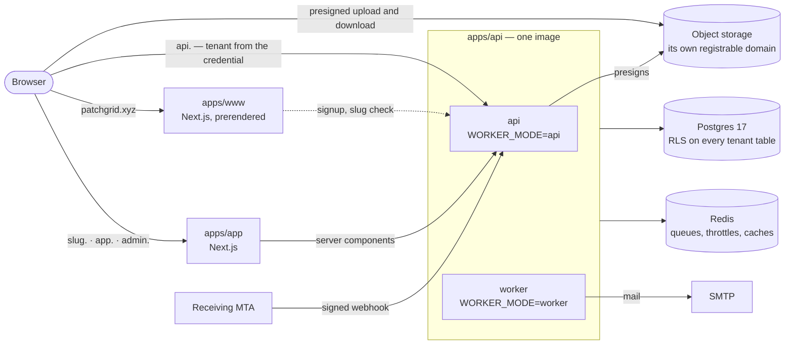
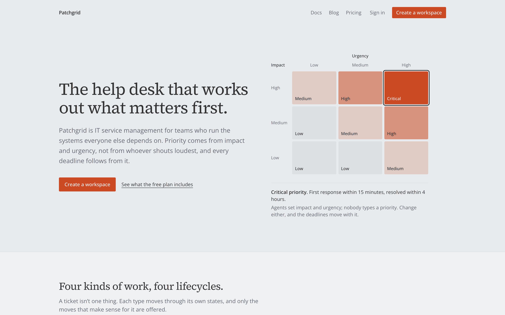
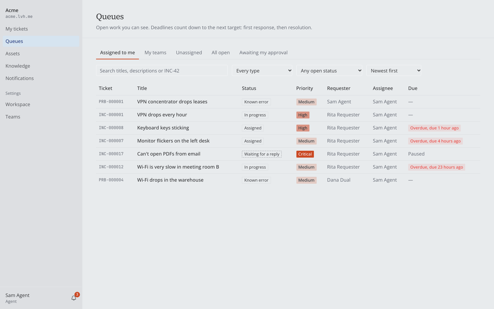
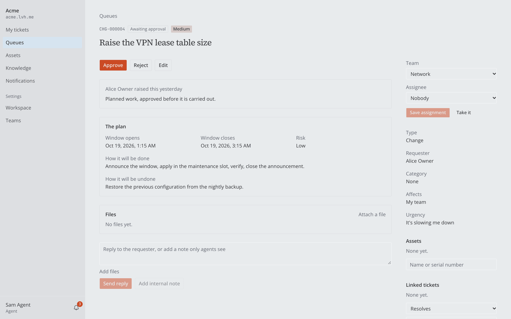
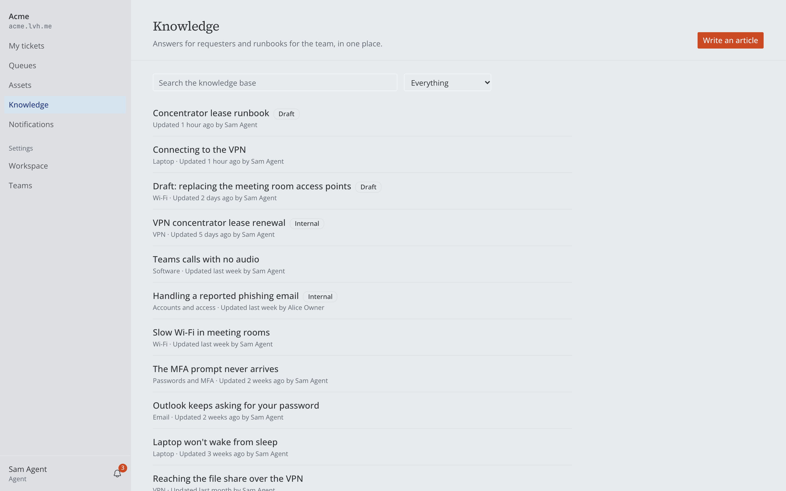

# Patchgrid

[](https://github.com/KhaledSaeed18/patchgrid/actions/workflows/ci.yml)
[](https://github.com/KhaledSaeed18/patchgrid/actions/workflows/codeql.yml)
[](LICENSE)
[](.nvmrc)

A **multi-tenant IT service management platform** — ticketing and operations for IT
and security teams, built as a production-grade reference rather than a tutorial.

Incidents, service requests, problems and changes are four different things with four
different lifecycles. Priority is computed from impact × urgency, never typed into a
dropdown. Each company gets its own subdomain, and its data is isolated at the
**database** level — not by remembering to add a `WHERE` clause.

```
patchgrid.xyz           marketing            apps/www    Next.js
<slug>.patchgrid.xyz    tenant workspace     apps/app    Next.js
api.patchgrid.xyz       everything else      apps/api    NestJS
```

## Architecture



The application connects as `patchgrid_app`, a role with no `BYPASSRLS`, and sets the tenant with a
transaction-local `set_config` before every query. Jobs carry their `orgId` and run inside that tenant.
Images and the production topology: [`ARCHITECTURE.md`](docs/ARCHITECTURE.md#production-images-and-the-deployment-shape).

| | |
| --- | --- |
|  |  |
|  |  |

## Isolation, in five layers

The thing this project is actually about:

0. **Schema shape** — composite `(orgId, id)` foreign keys, so a cross-tenant
   reference is _unrepresentable_. PostgreSQL runs referential-integrity checks with
   row security off, so this is the layer the other four cannot provide.
1. **Request context** — the tenant comes from the credential, never the host
2. **Repository arguments** — every method takes an explicit `orgId`
3. **Prisma client extension** — transaction-local `set_config`, throws without context
4. **Postgres RLS** — `FORCE ROW LEVEL SECURITY`, and an app role that holds no `BYPASSRLS`

The same discipline reaches everything that runs without a request. Background jobs
carry their `orgId` and run inside that tenant. Sweeps go dispatcher → one job per
tenant, never one global scan. The live notification stream listens on
`org:<orgId>` for the credential's org only, and sends a ticket event only to
members who could open that ticket — a CI test holds that decision equal to the one
`GET /tickets/:id` makes. A tenancy suite of numbered assertions gates every merge.

## What works today

- **Workspaces and people** — signup and provisioning, invitations, roles on the
  membership (`REQUESTER ⊂ AGENT ⊂ ADMIN ⊂ OWNER`), multi-team agents, team leads,
  per-tenant sessions, an org picker for people in several workspaces, audit log.
- **Incidents end to end** — a portal for requesters and a console for agents:
  - computed priority and per-org numbers (`INC-000042`), routing by category;
  - a transition table with required notes, and stale-write `409`s;
  - public replies and internal notes, watchers, and full-text search.
- **Four record types, four lifecycles** — service requests; problems with root
  cause, workaround and known errors; changes with a plan, a risk, an approval by
  someone other than their author, and a recorded outcome. Tickets link to each
  other (caused by, resolves, duplicate of, relates to), read from either end.
- **Files** — attachments on tickets and replies, uploaded straight to object storage
  with a presigned URL, checked by their bytes rather than their name, and served
  from a domain that shares nothing with the app. Each workspace has a storage quota.
- **Assets** — a register of laptops, phones, printers, network kit and licences:
  who has each, its warranty, and every ticket raised about it. Requesters see
  their own and name them when they raise a ticket.
- **Email intake** — mail to `<slug>@inbound.<domain>` becomes a ticket, and a reply to a
  ticket email lands on its ticket. That only happens when the sender passes DMARC and is a
  member. Everything else is recorded in an admin's inbound log and left at that: forged
  senders, strangers, autoresponders and floods.
- **Knowledge base** — markdown articles that are drafts, internal runbooks or
  published to the workspace. Full-text search; versioned edits; suggestions under
  a new ticket's title while a requester types.
- **SLA clocks** — response and resolution targets with pause on pending. A
  per-tenant scan flags warnings and breaches once each and audits them. Resolved
  tickets auto-close after seven days.
- **Hardening** — a second factor for members, required per workspace if an owner says so,
  with a fresh proof before deleting the workspace, making an owner, granting support access
  or minting a token; traces and metrics that say which tenant is slow; a browser suite that
  proves one workspace's session reaches nothing of another's.
- **Notifications** —
  - a bell and inbox, with a burst on one ticket folded into one row;
  - live updates over Server-Sent Events, including an "assigned to you" toast and
    queues and ticket pages that refresh themselves;
  - email for assignments, replies, status changes and SLA events, with
    preferences per membership and a workspace-wide off switch.
- **Reports** — SLA compliance by priority, type, team, category or assignee, time to resolve
  (median and p90), the open backlog by age, and who holds the work, with a CSV download.
- **Saved views and bulk actions** — a queue's filters saved for oneself or a team, and up to two
  hundred tickets assigned or moved at once, each ticket answering for itself.
- **Webhooks** — an admin subscribes an https endpoint to ticket events. Requests are signed
  (Standard Webhooks), carry ids and states but never a ticket's words, are retried with growing
  waits, pause a failing endpoint behind a circuit breaker, and can be replayed from a delivery log.
  An address that resolves anywhere private is refused at the moment of connecting.
- **Housekeeping jobs** — audit-log partitions kept a month ahead and archived past
  seven years, a nightly repair of the org picker's projection, and a sweep that
  clears uploads nobody finished and gives their quota back.
- **The platform layer** —
  - an operator back-office at `admin.<domain>`, behind its own login and a TOTP second
    factor, that sees workspace metadata and never their content;
  - support access an owner grants for a few hours: read-only, through the workspace's own
    routes, every page it opens written to the workspace's audit log;
  - scoped API tokens, each its own service account, so a monitoring system can raise
    incidents and can never manage members, settings or other tokens;
  - deleting a workspace: thirty days to change your mind, then a purge that leaves only
    a nameless record, so its address is never reused;
  - a workspace export streamed as a zip, self-service account erasure that keeps what
    you wrote under "Former member", and retention sweeps.

## Why it is built this way

Every choice here has a decision record with the alternatives it beat. The ones that shape the most:

- **Shared schema, row-level security, and composite foreign keys** — not a schema or database per
  tenant, and not RLS alone: PostgreSQL checks foreign keys with row security off, so `(orgId, id)` keys
  make a cross-tenant reference impossible to write.
  [ADR-0015](docs/decisions/0015-tenant-isolation-rls.md) ·
  [ADR-0023](docs/decisions/0023-identity-keys-and-tenant-safe-foreign-keys.md) ·
  [post](apps/www/content/blog/foreign-keys-that-leak.mdx)
- **The tenant comes from the credential**, never from the `Host` or a request field; the origin is a
  cross-check. [ADR-0024](docs/decisions/0024-per-tenant-cookies-and-api-tenant-resolution.md) ·
  [post](apps/www/content/blog/the-tenant-comes-from-the-credential.mdx)
- **Priority is computed** from impact and urgency, and a client that sends one gets a `400`; SLA clocks
  run 24×7 and pause only while waiting on the requester.
  [ADR-0003](docs/decisions/0003-sla-24x7-with-pending-pause.md) · [post](apps/www/content/blog/priority-is-computed.mdx)
- **Four lifecycles, one transition endpoint** — per-type state machines and extension tables, and
  status changes only through `POST /tickets/:id/transitions`.
  [ADR-0002](docs/decisions/0002-per-type-state-machines-and-extension-tables.md) ·
  [ADR-0006](docs/decisions/0006-explicit-transition-endpoint.md)
- **Authorization in the service, on a resolved subject**, deny by default, with visibility as a list
  of query branches rather than one `where`. Reads you may not see are `404`, actions you may not take
  `403`. [ADR-0019](docs/decisions/0019-rbac-model-and-enforcement.md)
- **Background work is per tenant** — a dispatcher fans out one job per workspace, never one global
  scan. [ADR-0018](docs/decisions/0018-tenant-aware-jobs-and-events.md)
- **A transactional outbox, read as a log** — what follows a change is written in the change's own
  transaction and read in transaction-id order below the snapshot horizon, so nothing is lost, repeated
  or skipped; each consumer keeps its own cursor.
  [ADR-0049](docs/decisions/0049-transactional-outbox-as-a-tenant-log.md)
- **Reports from a read model of their own** — a fact row per ticket, refreshed from the log and
  checked nightly against the tickets, so reports never compete with the queues.
  [ADR-0051](docs/decisions/0051-reporting-read-side.md)
- **Webhooks nobody else pays for** — thin signed events, at least once, a circuit with one probe, a
  per-tenant in-flight cap, and SSRF checked in the connection's own `lookup`.
  [ADR-0050](docs/decisions/0050-outbound-webhooks.md)
- **API tokens are actors, not bypasses**: each is a service account whose scopes intersect its role.
  [ADR-0021](docs/decisions/0021-api-tokens-as-service-accounts.md)
- **No impersonation**: operators read a workspace only in an owner-granted, read-only, audited support
  session. [ADR-0020](docs/decisions/0020-consent-based-support-access.md)
- **Files never share a site with the app** — served from their own registrable domain, landing in a
  staging prefix until they are confirmed.
  [ADR-0037](docs/decisions/0037-attachments-on-their-own-registrable-domain.md) ·
  [ADR-0038](docs/decisions/0038-uploads-land-in-staging.md)
- **Mail is trusted on its verdict**, not its `From:` line: only DMARC-passing members raise tickets.
  [ADR-0039](docs/decisions/0039-inbound-mail-feed-and-verdict.md)
- **Step-up before the irreversible** — a fresh second-factor proof to delete a workspace, make an owner,
  grant support access or mint a token. [ADR-0045](docs/decisions/0045-member-mfa-as-built.md)
- **Traces that know the tenant**, with the metrics label bounded so one noisy workspace cannot blow
  up the series count. [ADR-0046](docs/decisions/0046-observability-as-built.md)

The [threat model](docs/THREAT-MODEL.md) records what a three-way security review found and how each
finding was fixed ([post](apps/www/content/blog/what-a-security-review-found.mdx)).

## Running it

You need Node 24, pnpm 10 and Docker. From a fresh clone:

```bash
pnpm install
pnpm local:up   # .env, containers, roles, migrations, the isolation checks (6/6), the demo seed
pnpm dev
```

`pnpm local:up` is safe to run again; `pnpm db:reset` starts the database over.

`www` on `lvh.me:3000`, `app` on `<slug>.lvh.me:3001`, `api` on `api.lvh.me:4000`.
Outgoing mail lands in Mailpit at `localhost:8025`. To mail a ticket in, run
`pnpm --filter @patchgrid/api run inbound:send -- --from rita@patchgrid.test --to acme`.
It signs the message as the receiving server would; add `--dmarc fail` to see a forged one
refused. Attachments are served by MinIO
at `localhost:9000` — a different site from `lvh.me`, as files must be (ADR-0037).

To see which tenant is slow, start the observability profile and point the API at it
(ADR-0030, ADR-0046): `docker compose --profile observability up -d`, then set
`OTEL_EXPORTER_OTLP_ENDPOINT=http://localhost:4318` in `.env` and restart `pnpm dev`. Grafana is at
`localhost:3100` with the dashboard "Patchgrid — which tenant is slow"; traces in Tempo carry the
tenant, and a 5xx's `correlationId` is the trace id.

Sign in at `app.lvh.me:3001` with password `patchgrid-demo`:

| Account | Who they are |
| --- | --- |
| `dana@patchgrid.test` | Admin at Acme and agent at Globex — sees the workspace picker; also the platform operator at `admin.lvh.me:3001`, who enrols a TOTP factor on first sign-in |
| `sam@patchgrid.test` | Agent at Acme |
| `rita@patchgrid.test` | Requester at Acme |

### Tests

```bash
pnpm turbo lint typecheck test build
pnpm test:tenancy                                      # schema catalog + isolation suite
pnpm test:authz                                        # permission matrix + route coverage
pnpm --filter @patchgrid/api run test:integration      # real Postgres, Redis and queues
pnpm --filter @patchgrid/database run test:integration
```

Time is injected, so SLA and worker tests run on fake timers and nothing sleeps.

## Documentation

The docs are the specification, not a description written afterwards.

|                                                                                     |                                                               |
| ----------------------------------------------------------------------------------- | ------------------------------------------------------------- |
| [`docs/HANDOFF.md`](docs/HANDOFF.md)                                                | **Start here** — what is built, what is not, what comes next  |
| [`docs/PROJECT.md`](docs/PROJECT.md)                                                | What this is, and what it deliberately is not                 |
| [`docs/TENANCY.md`](docs/TENANCY.md) · [`docs/RBAC.md`](docs/RBAC.md)               | Isolation between tenants; authorization within one           |
| [`docs/DOMAIN.md`](docs/DOMAIN.md) · [`docs/ARCHITECTURE.md`](docs/ARCHITECTURE.md) | ITSM rules; stack, pipeline and data model                    |
| [`docs/ENGINEERING.md`](docs/ENGINEERING.md) · [`docs/DNS.md`](docs/DNS.md)         | How we work; hostnames, TLS and mail                          |
| [`docs/THREAT-MODEL.md`](docs/THREAT-MODEL.md)                                      | Assets, actors, trust boundaries, STRIDE — and accepted risks |
| [`docs/FEATURES.md`](docs/FEATURES.md)                                              | The backlog, milestone by milestone                           |
| [`docs/decisions/`](docs/decisions/)                                                | 52 ADRs — _why_ any of it is this way                         |

## Status

**M0 (foundation) through M6, and M8 to M11, are complete:**
- tenancy and identity;
- the incident lifecycle;
- SLA sweeps and notifications;
- service requests, problems and changes;
- attachments, assets and the knowledge base;
- tickets raised and answered by email;
- the platform layer: back-office, support access, API tokens, deletion and data protection;
- hardening: a second factor for members with step-up before irreversible actions, a browser
  suite across two tenants with the negative cases, OpenTelemetry with per-tenant metrics and a
  Grafana dashboard, a security review of every trust boundary (`docs/THREAT-MODEL.md` §7), OpenAPI
  at `/api/docs`, and a load check at a hundred thousand tickets;
- shipping, locally (ADR-0047);
- reliable delivery: the outbox, webhooks and their retention;
- insight: reports from a read side, saved views and bulk actions.

**M10, ship, is complete**: the demo seed across every type and status, the marketing site with its
docs and blog, production images and `docker-compose.prod.yml`, and this README. Patchgrid is not
deployed publicly ([ADR-0047](docs/decisions/0047-no-public-deployment.md)) — it is a learning project
that runs on a laptop, and the wildcard DNS, TLS and mail design in `docs/DNS.md` stays a design.

**M11, reliable delivery, is complete**: a transactional outbox read as a per-tenant log, ticket
notifications on it, outbound webhooks as its second consumer, retention, and a review of all three
(`docs/THREAT-MODEL.md` §8).

**M12, insight, is complete**: SLA, backlog and workload reports from a read model of their own, every
one under 25 ms at a hundred thousand tickets; saved views; and bulk actions that are the single action
per ticket (`docs/THREAT-MODEL.md` §9).

**Next is M13**, identity: passkeys, and per-tenant OIDC single sign-on against a local Keycloak. Then
M14 (a production rehearsal on a laptop), and M7 last, because it needs local models
([ADR-0048](docs/decisions/0048-roadmap-after-m10.md)). `docs/HANDOFF.md` has the detail.

MIT licensed — the value of this repository is that people read it.
